One robot, one job
==================

<!-- column_layout: [5, 6] -->

<!-- column: 0 -->

**The mission:** scout every row of a two-hectare field.

* Photograph every plant
* Never touch a person
* Be back on the charger before the battery runs out

<!-- new_line -->

Same robot, same sensors, **five different brains**.

Which one would you trust?

<!-- column: 1 -->

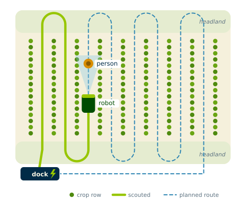

<!-- reset_layout -->

<!-- speaker_note: Keep this robot in mind for the whole lecture. Every architecture we meet gets tested on the same mission. -->

<!-- end_slide -->

The plan for today
==================

```faqe:grid
columns = 3
variant = "cards"

[[items]]
eyebrow = "Part 1"
title = "Think first"
body = "Deliberative control: Shakey, sense–plan–act, A*"
tone = "accent"

[[items]]
eyebrow = "Part 2"
title = "Act first"
body = "Reactive control: subsumption and motor schemas"
tone = "positive"

[[items]]
eyebrow = "Part 3"
title = "Do both"
body = "Hybrid three-layer architectures and Nav2"
tone = "neutral"

[[items]]
eyebrow = "Part 4"
title = "State machines"
body = "Writing the sequencer as an FSM"
tone = "muted"

[[items]]
eyebrow = "Part 5"
title = "Behaviour trees"
body = "Modular, reactive sequencing"
tone = "positive"

[[items]]
eyebrow = "Part 6"
title = "What comes next"
body = "Language models and learned policies"
tone = "warning"
```

<!-- end_slide -->

Three primitives
================

Every robot program is built from three primitives. An **architecture** is the way you wire them together (Murphy, 2019).

```faqe:grid
columns = 3
variant = "cards"

[[items]]
eyebrow = "SENSE"
title = "sensor data → information"
body = "Lidar returns become *person 3 m ahead*. Camera pixels become *row centre 4 cm to the left*."
tone = "neutral"

[[items]]
eyebrow = "PLAN"
title = "information → directives"
body = "*Rows 1–4 done, battery at 62 %* becomes *scout row 5, then dock*."
tone = "accent"

[[items]]
eyebrow = "ACT"
title = "information or directives → commands"
body = "*Steer 2° left at 0.8 m/s* becomes a speed for each wheel."
tone = "positive"
```

<!-- end_slide -->

Structure and style
====================

A robot architecture has a **structure**, which is how the system is split into components, and a **style**, which is how those components talk to each other (Kortenkamp, Simmons & Brugali, 2016).

```faqe:graph
caption = "Boxes are the structure. Arrows are the style: here ROS 2 topics (publish/subscribe). Services and actions are other styles."
description = "Sensors feed perception nodes, which feed a behaviour coordinator, which commands the base controller and the wheels."
columns = 5
rows = 3

[[nodes]]
id = "lidar"
title = "lidar"
column = 1
row = 1
tone = "muted"

[[nodes]]
id = "camera"
title = "row camera"
column = 1
row = 2
tone = "muted"

[[nodes]]
id = "gnss"
title = "GNSS"
column = 1
row = 3
tone = "muted"

[[nodes]]
id = "obstacles"
title = "obstacle detector"
column = 2
row = 1
tone = "neutral"

[[nodes]]
id = "rowdet"
title = "row detector"
column = 2
row = 2
tone = "neutral"

[[nodes]]
id = "loc"
title = "localisation"
column = 2
row = 3
tone = "neutral"

[[nodes]]
id = "coord"
title = "behaviour coordination"
subtitle = "decides what to do"
column = 3
row = 2
tone = "accent"

[[nodes]]
id = "base"
title = "base controller"
column = 4
row = 2
tone = "positive"

[[nodes]]
id = "wheels"
title = "wheels"
column = 5
row = 2
tone = "muted"

[[edges]]
from = "lidar"
to = "obstacles"
label = "/scan"

[[edges]]
from = "camera"
to = "rowdet"
label = "/image"

[[edges]]
from = "gnss"
to = "loc"
label = "/fix"

[[edges]]
from = "obstacles"
to = "coord"
label = "/obstacles"

[[edges]]
from = "rowdet"
to = "coord"
label = "/row_offset"

[[edges]]
from = "loc"
to = "coord"
label = "/pose"

[[edges]]
from = "coord"
to = "base"
label = "/cmd_vel"

[[edges]]
from = "base"
to = "wheels"
label = "PWM"
```

<!-- end_slide -->

Why robots need their own architectures
=======================================

```faqe:grid
columns = 4
variant = "cards"

[[items]]
eyebrow = "1"
title = "Real time"
body = "A late answer is a wrong answer. At 1 m/s, 100 ms of thinking is 10 cm of driving."
tone = "negative"

[[items]]
eyebrow = "2"
title = "Uncertainty"
body = "Sensors are noisy, wheels slip, maps are wrong and people move."
tone = "warning"

[[items]]
eyebrow = "3"
title = "Many time scales"
body = "Reflexes in milliseconds, decisions in seconds, plans in minutes."
tone = "accent"

[[items]]
eyebrow = "4"
title = "Concurrency"
body = "Follow the row *and* watch for people *and* track the battery, all at once."
tone = "positive"
```

<!-- new_line -->

General-purpose software design helps, but none of it was built for a program that crashes into a person when it runs late.

<!-- end_slide -->

Many clocks, one robot
======================


<!-- speaker_note: Six orders of magnitude. No single loop can serve all of these; this is the strongest argument for layering. -->

<!-- end_slide -->

Divide and conquer
==================

<!-- column_layout: [2, 3] -->

<!-- column: 0 -->

* **Task decomposition**: break the job into sub-tasks
* **Temporal decomposition**: put them in order
* **Hierarchy**: higher levels are more abstract and change more slowly

<!-- new_line -->

Read the tree top-down for the task decomposition and left to right for the temporal one.

<!-- column: 1 -->

```faqe:graph
description = "Scout field splits into plan route, scout rows and return to dock; scout rows splits into go to row start, follow row and headland turn."
columns = 4
rows = 3

[[nodes]]
id = "root"
title = "scout field"
column = 2
row = 1
tone = "accent"

[[nodes]]
id = "plan"
title = "plan route"
column = 1
row = 2
tone = "neutral"

[[nodes]]
id = "rows"
title = "scout rows"
column = 2
row = 2
tone = "neutral"

[[nodes]]
id = "home"
title = "return to dock"
column = 4
row = 2
tone = "neutral"

[[nodes]]
id = "start"
title = "go to row start"
column = 1
row = 3
tone = "positive"

[[nodes]]
id = "follow"
title = "follow row"
column = 2
row = 3
tone = "positive"

[[nodes]]
id = "turn"
title = "headland turn"
column = 3
row = 3
tone = "positive"

[[nodes]]
id = "charge"
title = "charge"
column = 4
row = 3
tone = "positive"

[[edges]]
from = "root"
to = "plan"

[[edges]]
from = "root"
to = "rows"

[[edges]]
from = "root"
to = "home"

[[edges]]
from = "rows"
to = "start"

[[edges]]
from = "rows"
to = "follow"

[[edges]]
from = "rows"
to = "turn"

[[edges]]
from = "home"
to = "charge"
```

<!-- reset_layout -->

<!-- end_slide -->

Sixty years in one slide
========================

```faqe:timeline
[[items]]
title = "Shakey plans with STRIPS and A*"
meta = "1966–1972 · SRI"
tone = "accent"

[[items]]
title = "Brooks: subsumption, layers of behaviour"
meta = "1986 · MIT"
tone = "positive"

[[items]]
title = "Arkin: motor schemas, AuRA hybrid"
meta = "1987–1989 · Georgia Tech"
tone = "positive"

[[items]]
title = "Three-layer architectures: ATLANTIS, 3T"
meta = "1991–1998 · JPL, NASA"
tone = "neutral"

[[items]]
title = "Behaviour trees in game AI (Halo 2)"
meta = "2004"
tone = "muted"

[[items]]
title = "Nav2: behaviour trees drive ROS 2 navigation"
meta = "2020"
tone = "neutral"

[[items]]
title = "SayCan: a language model as the planner"
meta = "2022 · Google"
tone = "warning"
```

<!-- end_slide -->

<!-- jump_to_middle -->

Think first
===========

Part 1 · the deliberative paradigm


<!-- end_slide -->

Shakey, SRI 1966–1972
=====================

<!-- column_layout: [3, 2] -->

<!-- column: 0 -->

* The first mobile robot that **reasoned about its own actions**
* TV camera, laser range finder and bump detectors
* Its "brain" was a computer in another room, reached over a **radio link**
* Gave us **STRIPS** planning, the **A\*** search algorithm and the **Hough transform** as we use it today
* Inducted into the Robot Hall of Fame in 2004 and an IEEE Milestone in 2017

<!-- column: 1 -->


<!-- reset_layout -->

*Photo: SRI International, CC BY-SA 3.0, via Wikimedia Commons*

<!-- end_slide -->

Sense, then plan, then act
==========================

The **hierarchical paradigm**: sense everything, update one world model, plan, and only then act. Every module waits for the one before it.

```faqe:graph
description = "Sensors feed perception, which updates the world model; the planner reads the model and hands a plan to the executor, which drives the motors."
columns = 6
rows = 1

[[nodes]]
id = "sense"
title = "sensors"
column = 1
row = 1
tone = "muted"

[[nodes]]
id = "perc"
title = "perception"
subtitle = "SENSE"
column = 2
row = 1
tone = "neutral"

[[nodes]]
id = "model"
title = "world model"
subtitle = "SENSE"
column = 3
row = 1
tone = "neutral"

[[nodes]]
id = "plan"
title = "planner"
subtitle = "PLAN"
column = 4
row = 1
tone = "accent"

[[nodes]]
id = "exec"
title = "executor"
subtitle = "ACT"
column = 5
row = 1
tone = "positive"

[[nodes]]
id = "motors"
title = "motors"
column = 6
row = 1
tone = "muted"

[[edges]]
from = "sense"
to = "perc"

[[edges]]
from = "perc"
to = "model"

[[edges]]
from = "model"
to = "plan"

[[edges]]
from = "plan"
to = "exec"

[[edges]]
from = "exec"
to = "motors"
```

<!-- new_line -->

It is clean, predictable and optimal **if** the world model is complete and correct and the world holds still while you think.

<!-- end_slide -->

A planner is a search
=====================

<!-- column_layout: [1, 1] -->

<!-- column: 0 -->

* Shakey's team created **A\*** to find routes on its map (Hart, Nilsson & Raphael, 1968)
* Expand the cell with the lowest **f(n) = g(n) + h(n)**
  * *g*: cost so far
  * *h*: estimated cost to go
* Finds the shortest path whenever *h* never overestimates
* Still the backbone of grid planners, including Nav2's

<!-- column: 1 -->


<!-- reset_layout -->

<!-- end_slide -->

The scout, deliberatively
=========================

```python
def deliberative_scout(robot, planner):
    while not robot.mission_done():
        world = build_world_model(robot.read_all_sensors())    # seconds
        plan = planner.solve(world, goal="all rows scouted")    # seconds to minutes
        for step in plan:                                       # open loop:
            robot.execute(step)                                 # nothing is sensed here
```

<!-- new_line -->

Clean and easy to reason about. Now a person walks into row 3 while the `for` loop is running.

<!-- pause -->

<!-- new_line -->

**Nothing in this loop will notice.**

<!-- end_slide -->

Where it breaks
===============

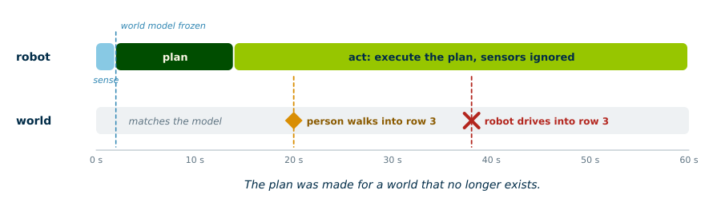

```faqe:grid
columns = 3
variant = "compact"

[[items]]
title = "Slow"
body = "The robot stands still while it plans."
tone = "warning"

[[items]]
title = "Blind"
body = "Plans run without looking at the world."
tone = "negative"

[[items]]
title = "Brittle"
body = "Anything the model does not contain does not exist."
tone = "negative"
```

<!-- end_slide -->

<!-- jump_to_middle -->

Act first
=========

Part 2 · the reactive paradigm


<!-- end_slide -->

The world is its own best model
===============================

> "The world is its own best model." Rodney Brooks, *Elephants Don't Play Chess* (1990)

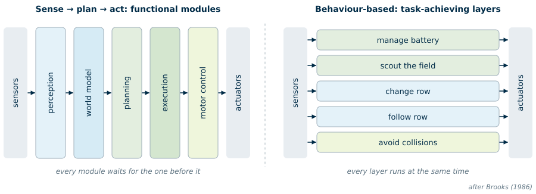

<!-- speaker_note: Brooks rotates the diagram by ninety degrees. Instead of slicing by function, slice by behaviour. Each slice is a complete, working robot. -->

<!-- end_slide -->

Subsumption architecture
========================

Each level is a complete sensor-to-actuator behaviour. A higher level **suppresses** (S) the command of the level below while it is active. Lower levels keep running unchanged, so level 0 is tested before level 1 is written (Brooks, 1986).

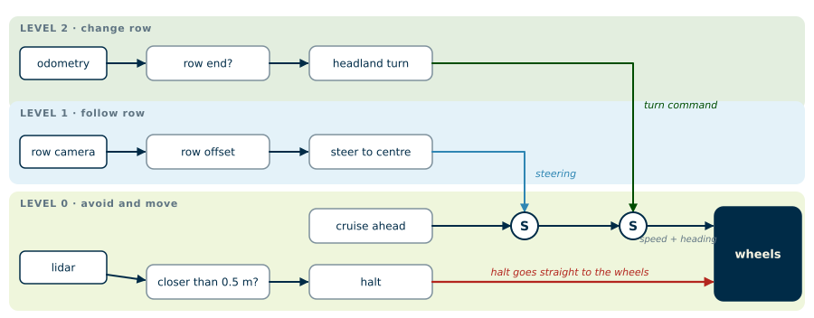

<!-- end_slide -->

Who wins?
=========

```faqe:table
caption = "Arbitration by fixed priority: the highest active level decides, except for the safety reflex, which is wired past the switches."
variant = "matrix"
columns = ["Situation", "Level 0 · avoid", "Level 1 · follow row", "Level 2 · change row", "Wheels get"]

[[rows]]
cells = ["Open row", "cruise ahead", "steer to centre", "—", "steer to centre"]
tones = ["neutral", "muted", "positive", "muted", "positive"]

[[rows]]
cells = ["End of the row", "cruise ahead", "no row visible", "headland turn", "headland turn"]
tones = ["neutral", "muted", "muted", "positive", "positive"]

[[rows]]
cells = ["Person 0.4 m ahead", "halt", "steer to centre", "—", "halt"]
tones = ["neutral", "negative", "muted", "muted", "negative"]

[[rows]]
cells = ["Turning, person ahead", "halt", "no row visible", "headland turn", "halt"]
tones = ["neutral", "negative", "muted", "muted", "negative"]
```

<!-- end_slide -->

Motor schemas: blend, don't pick
================================

<!-- column_layout: [2, 3] -->

<!-- column: 0 -->

* Each behaviour is a **motor schema** that outputs a velocity vector (Arkin, 1989)
* *move-to-goal*: a unit vector towards the goal
* *avoid-obstacle*: pushes away, more strongly when closer
* The robot follows the **sum**: cooperative coordination
* The same idea as artificial **potential fields**

<!-- column: 1 -->


<!-- reset_layout -->

<!-- end_slide -->

When the vectors cancel
=======================

<!-- column_layout: [2, 3] -->

<!-- column: 0 -->

* Attraction and repulsion can **cancel out**: a local minimum
* The robot stops or oscillates inside the cup
* Arkin's fixes:
  * a small **noise** schema to shake it loose
  * an **avoid-past** schema that pushes away from where it has been
* Or let something that can *plan* take over (Part 3)

<!-- column: 1 -->

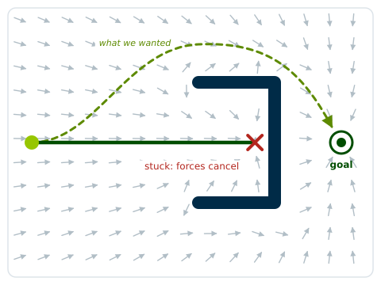

<!-- reset_layout -->

<!-- end_slide -->

Competitive or cooperative?
===========================

```faqe:table
variant = "comparison"
columns = ["Aspect", "Subsumption · competitive", "Motor schemas · cooperative"]

[[rows]]
cells = ["Coordination", "one behaviour wins, by priority", "all behaviours add up"]

[[rows]]
cells = ["Output", "whoever is on top", "a weighted blend"]

[[rows]]
cells = ["Strong at", "predictable, easy to check for safety", "smooth paths, graceful trade-offs"]
tones = ["neutral", "positive", "positive"]

[[rows]]
cells = ["Weak at", "jerky switching, ignores advice from below", "local minima, weights need tuning"]
tones = ["neutral", "negative", "negative"]
```

<!-- new_line -->

Real systems mix both: blend inside a layer, prioritise between layers.

<!-- end_slide -->

Reactive control: gains and losses
==================================

```faqe:grid
columns = 2
variant = "cards"

[[items]]
title = "What we gained"
tone = "positive"
bullets = ["Responds within milliseconds", "No world model to keep up to date", "Robust: layers fail independently", "The scout stops for the person, every time"]

[[items]]
title = "What we lost"
tone = "negative"
bullets = ["No memory: which rows are already done?", "No foresight: when should it go and charge?", "Behaviour emerges, so it is hard to predict and debug", "Every new layer is harder to add than the last"]
```

<!-- end_slide -->

A spectrum, not a choice
========================


<!-- end_slide -->

<!-- jump_to_middle -->

Do both
=======

Part 3 · hybrid three-layer architectures


<!-- end_slide -->

Three layers, three clocks
==========================


Three groups arrived at almost the same design independently: a fast reactive controller, a slow deliberator, and a sequencer that connects them (Gat, 1998).

<!-- end_slide -->

Controller: the skills
======================

<!-- column_layout: [1, 1] -->

<!-- column: 0 -->

* **Situated**: each skill is useful in one kind of situation
* **Cognizant failure**: a skill knows when it fails and says so
* **Fast and bounded**: constant time per cycle, very little state
* Skills never decide *what* to do next, only *how*

<!-- column: 1 -->

```faqe:grid
columns = 2
variant = "metrics"

[[items]]
title = "follow_row()"
badge = "10 Hz"
tone = "positive"

[[items]]
title = "headland_turn()"
badge = "20 Hz"
tone = "positive"

[[items]]
title = "go_to(pose)"
badge = "20 Hz"
tone = "positive"

[[items]]
title = "stop_and_wait()"
badge = "50 Hz"
tone = "warning"

[[items]]
title = "dock()"
badge = "20 Hz"
tone = "positive"

[[items]]
title = "capture_image()"
badge = "on trigger"
tone = "neutral"
```

<!-- reset_layout -->

<!-- end_slide -->

Sequencer: the executive
========================

<!-- column_layout: [3, 2] -->

<!-- column: 0 -->

* Turns a plan into **which skill runs now**, with which parameters
* Remembers what has happened: rows done, last failure
* Monitors progress and handles exceptions
* Gat's rule: the sequencer must never compute for longer than the world takes to change at its level

<!-- new_line -->

This is the layer you will write as a **state machine** (Part 4) or a **behaviour tree** (Part 5).

<!-- column: 1 -->

```faqe:graph
description = "The sequencer steps through go to row start, follow row and headland turn, then picks the next row."
columns = 1
rows = 4

[[nodes]]
id = "plan"
title = "plan: rows 5, 6, 7"
tone = "accent"
column = 1
row = 1

[[nodes]]
id = "start"
title = "go_to(start of row 5)"
tone = "positive"
column = 1
row = 2

[[nodes]]
id = "follow"
title = "follow_row()"
tone = "positive"
column = 1
row = 3

[[nodes]]
id = "turn"
title = "headland_turn()"
tone = "positive"
column = 1
row = 4

[[edges]]
from = "plan"
to = "start"

[[edges]]
from = "start"
to = "follow"
label = "arrived"

[[edges]]
from = "follow"
to = "turn"
label = "row end"
```

<!-- reset_layout -->

<!-- end_slide -->

Deliberator: the planner
========================

<!-- column_layout: [1, 1] -->

<!-- column: 0 -->

* Slow, thorough, works on a **model** of the field
* Decides which rows, in which order
* Decides when to go and charge
* Answers when the sequencer asks, or keeps planning in the background

<!-- column: 1 -->

```faqe:progress
title = "Planned battery level after each block"
caption = "Rows 9–12 would cross the reserve, so the planner adds a charging stop first."
max = 100

[[items]]
label = "Start"
value = 95
display = "95 %"
tone = "positive"

[[items]]
label = "Rows 1–4"
value = 64
display = "64 %"
tone = "positive"

[[items]]
label = "Rows 5–8"
value = 33
display = "33 %"
tone = "warning"

[[items]]
label = "Charge"
value = 100
display = "100 %"
tone = "accent"

[[items]]
label = "Rows 9–12"
value = 61
display = "61 %"
tone = "positive"

[[markers]]
label = "reserve 20 %"
value = 20
tone = "negative"
```

<!-- reset_layout -->

<!-- end_slide -->

Failure goes up, commands come down
===================================

```faqe:timeline
[[items]]
title = "follow_row() reports FAILURE: a crate blocks row 7"
meta = "controller · within 100 ms"
tone = "negative"

[[items]]
title = "Recovery: wait 30 s, then back up 1 m. Still blocked."
meta = "sequencer · seconds"
tone = "warning"

[[items]]
title = "Asks for a new plan: scout row 7 from the far headland"
meta = "deliberator · about 2 s"
tone = "accent"

[[items]]
title = "Runs the new plan. The robot never stopped working."
meta = "sequencer → controller"
tone = "positive"
```

<!-- end_slide -->

Hybrid today: Nav2 in ROS 2
===========================


The ROS 2 navigation stack is a three-layer architecture, and its sequencer is a **behaviour tree** (Macenski et al., 2020).

<!-- end_slide -->

<!-- jump_to_middle -->

State machines
==============

Part 4 · writing the sequencer as an FSM


<!-- end_slide -->

Finite state machine
====================

A finite set of **states**, exactly **one active** at a time. Each state runs one skill. **Events** trigger **transitions**.

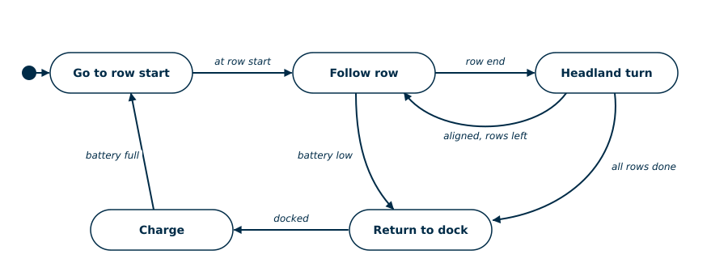

<!-- end_slide -->

The same machine as a table
===========================

```faqe:table
caption = "Every arrow is a row. A missing row is a bug: what should happen on battery low while the robot is turning?"
variant = "striped"
columns = ["From", "Event", "To"]

[[rows]]
cells = ["Go to row start", "at row start", "Follow row"]

[[rows]]
cells = ["Follow row", "row end", "Headland turn"]

[[rows]]
cells = ["Headland turn", "aligned, rows left", "Follow row"]

[[rows]]
cells = ["Headland turn", "all rows done", "Return to dock"]

[[rows]]
cells = ["Follow row", "battery low", "Return to dock"]
tones = ["neutral", "warning", "neutral"]

[[rows]]
cells = ["Return to dock", "docked", "Charge"]

[[rows]]
cells = ["Charge", "battery full", "Go to row start"]
```

<!-- end_slide -->

An FSM in Python
================

```python
from enum import Enum, auto

class State(Enum):
    GO_TO_ROW_START = auto(); FOLLOW_ROW = auto(); HEADLAND_TURN = auto()
    RETURN_TO_DOCK = auto(); CHARGE = auto()

def next_state(s, e):
    if e.battery_low and s not in (State.RETURN_TO_DOCK, State.CHARGE):
        return State.RETURN_TO_DOCK                  # one guard covers every state
    match s:
        case State.GO_TO_ROW_START if e.at_row_start: return State.FOLLOW_ROW
        case State.FOLLOW_ROW if e.row_end:           return State.HEADLAND_TURN
        case State.HEADLAND_TURN if e.aligned:
            return State.FOLLOW_ROW if e.rows_left else State.RETURN_TO_DOCK
        case State.RETURN_TO_DOCK if e.docked:        return State.CHARGE
        case State.CHARGE if e.battery_full:          return State.GO_TO_ROW_START
    return s

while True:                                          # 10 Hz control loop
    state = next_state(state, read_events())
    SKILLS[state]()                                  # one skill per state
```

<!-- end_slide -->

Now add one requirement
=======================

*Stop for any person, in any state, and carry on where you left off.*

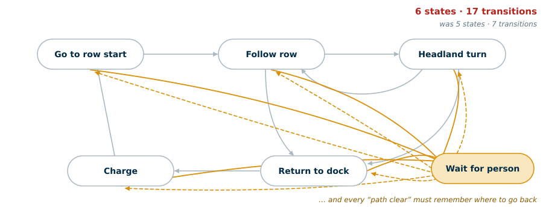

<!-- end_slide -->

Hierarchical state machines
===========================

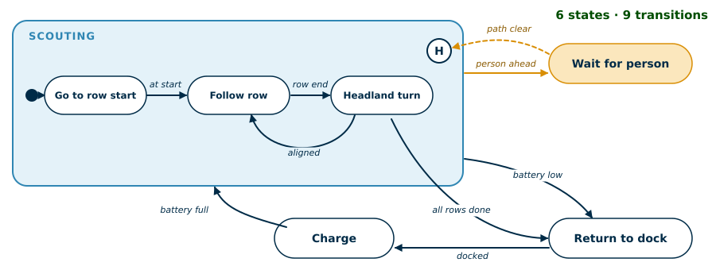

Group states into a **superstate** so one transition leaves the whole group. A **history** state (H) resumes where the robot left off. ROS tools: SMACH, FlexBE.

<!-- end_slide -->

<!-- jump_to_middle -->

Behaviour trees
===============

Part 5 · modular, reactive sequencing

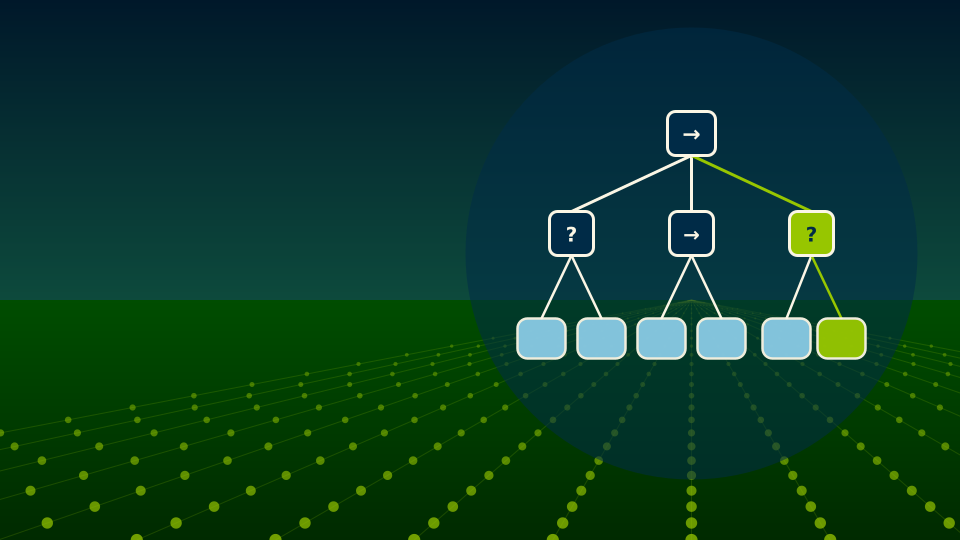

<!-- end_slide -->

Behaviour trees
===============

<!-- column_layout: [3, 2] -->

<!-- column: 0 -->

* Born in **game AI** (Halo 2, 2004) to keep character logic modular
* Brought to robotics by Ögren, Colledanchise and others: *Behavior Trees in Robotics and AI* (2018)
* The default sequencer in **Nav2**, built on BehaviorTree.CPP
* The tree is **ticked** from the root many times per second
* Every node answers the tick with one of three words

<!-- column: 1 -->

```faqe:grid
columns = 1
variant = "metrics"

[[items]]
title = "SUCCESS"
body = "done, it worked"
tone = "positive"

[[items]]
title = "FAILURE"
body = "done, it did not work"
tone = "negative"

[[items]]
title = "RUNNING"
body = "not finished, tick me again"
tone = "warning"
```

<!-- reset_layout -->

<!-- end_slide -->

Six kinds of node
=================

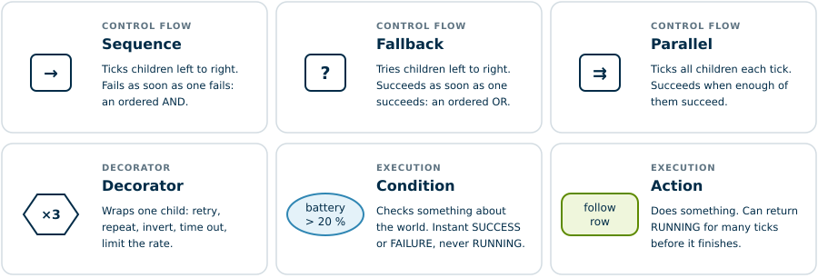

<!-- end_slide -->

Sequence and fallback
=====================

```faqe:table
variant = "matrix"
columns = ["Node", "SUCCESS when", "FAILURE when", "RUNNING when"]

[[rows]]
cells = ["→ Sequence", "all children succeed", "one child fails", "a child is running"]
tones = ["neutral", "positive", "negative", "warning"]

[[rows]]
cells = ["? Fallback", "one child succeeds", "all children fail", "a child is running"]
tones = ["neutral", "positive", "negative", "warning"]

[[rows]]
cells = ["⇉ Parallel", "at least M children succeed", "more than N − M fail", "otherwise"]
tones = ["neutral", "positive", "negative", "warning"]
```

<!-- new_line -->

The most common pattern is a fallback: *is the condition already true? If not, do something about it.*

<!-- end_slide -->

The scout as a behaviour tree
=============================

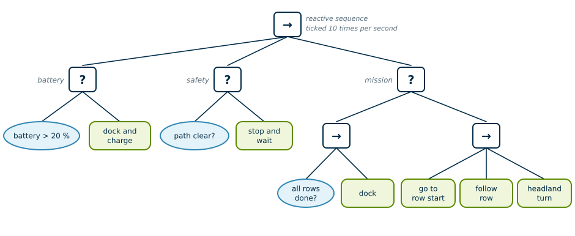

<!-- speaker_note: Read it left to right: first make sure the battery is fine, then that the path is clear, then do the mission. Each fallback says: if this condition holds, move on; otherwise fix it. -->

<!-- end_slide -->

Tick: driving along a row
=========================

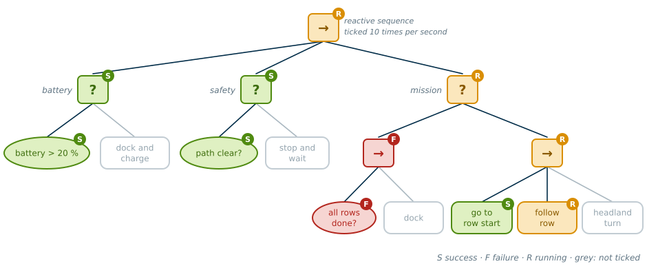

<!-- end_slide -->

Tick: a person steps in
=======================

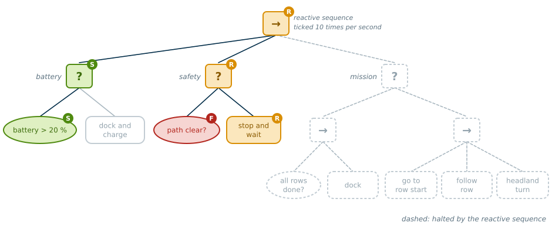

*path clear?* fails, so **stop and wait** runs and the reactive sequence halts the mission branch. When the person leaves, the next tick runs the mission again. No new transitions are needed.

<!-- end_slide -->

Pattern: guard actions with their goal
======================================

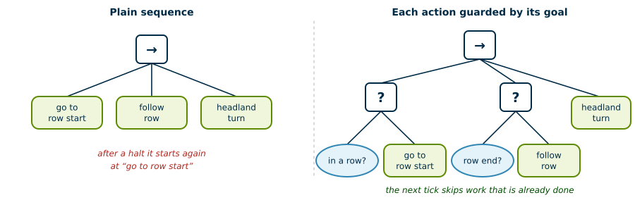

A halted sequence starts again from its first child. Put each action behind a fallback that checks whether its goal is already reached, and restarting costs nothing.

<!-- end_slide -->

A behaviour tree in Nav2
========================

<!-- column_layout: [3, 2] -->

<!-- column: 0 -->

```xml
<root BTCPP_format="4" main_tree_to_execute="MainTree">
  <BehaviorTree ID="MainTree">
    <PipelineSequence name="NavigateWithReplanning">
      <RateController hz="1.0">
        <ComputePathToPose goal="{goal}" path="{path}"/>
      </RateController>
      <FollowPath path="{path}" controller_id="FollowPath"/>
    </PipelineSequence>
  </BehaviorTree>
</root>
```

*Simplified from Nav2's navigate-with-replanning tree.*

<!-- column: 1 -->

* `ComputePathToPose` calls the **planner** at 1 Hz
* `FollowPath` calls the **controller**, which runs at about 20 Hz
* `{goal}` and `{path}` live on the **blackboard**, shared by all nodes
* A three-layer architecture in nine lines

<!-- reset_layout -->

<!-- end_slide -->

FSM or behaviour tree?
======================

```faqe:table
variant = "comparison"
columns = ["Aspect", "Finite state machine", "Behaviour tree"]

[[rows]]
cells = ["Control flow", "explicit transitions", "follows from the tree and the ticks"]

[[rows]]
cells = ["Interrupts", "one transition per state", "re-checked on every tick"]
tones = ["neutral", "negative", "positive"]

[[rows]]
cells = ["Modularity", "states know their neighbours", "subtrees are reusable and testable"]
tones = ["neutral", "warning", "positive"]

[[rows]]
cells = ["Readability", "excellent while small", "stays readable as it grows"]
tones = ["neutral", "positive", "positive"]

[[rows]]
cells = ["Best for", "short, clearly sequential tasks", "large, reactive, changing tasks"]
```

<!-- new_line -->

The evidence is mixed. In a mobile-manipulation study the robot behaved the same with either, but the BT was easier to maintain as the task grew (Iovino et al., 2023). For automatically designed swarm controllers, BTs did no better than FSMs (Ligot et al., 2020).

<!-- end_slide -->

<!-- jump_to_middle -->

What comes next
===============

Part 6 · language models and learned policies

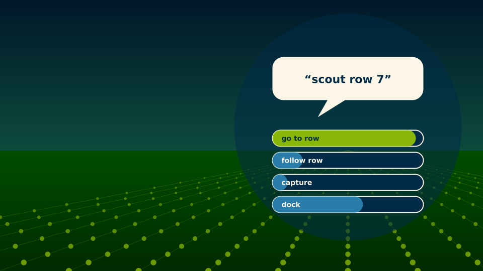

<!-- end_slide -->

A language model as the deliberator
===================================

<!-- column_layout: [1, 1] -->

<!-- column: 0 -->

* **SayCan** (Ahn et al., 2022): a language model scores how *useful* each skill is for the instruction (**Say**)
* A learned value function scores whether the skill *can* succeed from here (**Can**)
* Run the skill with the highest product, then ask again
* Tested on 101 instructions with a mobile robot in a real kitchen

<!-- column: 1 -->

```faqe:progress
title = "“Check the tomatoes in row 7”, robot at the dock"
caption = "Illustrative numbers. Say knows what is useful; Can knows what is possible here."
max = 0.4

[[items]]
label = "go_to(row 7)"
value = 0.38
display = "0.40 × 0.95"
tone = "positive"

[[items]]
label = "capture_image()"
value = 0.02
display = "0.35 × 0.05"
tone = "muted"

[[items]]
label = "follow_row()"
value = 0.02
display = "0.15 × 0.10"
tone = "muted"

[[items]]
label = "dock()"
value = 0.05
display = "0.05 × 0.90"
tone = "muted"
```

<!-- reset_layout -->

<!-- end_slide -->

Still three layers
==================

```faqe:graph
caption = "The language model replaces the hand-written planner; the skills are still ordinary controllers."
description = "An instruction goes to the language model, which proposes skills; value functions score them; the selected skill runs on the robot and the result feeds back."
columns = 5
rows = 2

[[nodes]]
id = "human"
title = "instruction"
subtitle = "“scout row 7”"
column = 1
row = 1
tone = "muted"

[[nodes]]
id = "llm"
title = "language model"
subtitle = "deliberator · Say"
column = 2
row = 1
tone = "accent"

[[nodes]]
id = "select"
title = "skill selection"
subtitle = "sequencer"
column = 3
row = 1
tone = "neutral"

[[nodes]]
id = "value"
title = "value functions"
subtitle = "Can"
column = 3
row = 2
tone = "warning"

[[nodes]]
id = "skills"
title = "skills"
subtitle = "controller"
column = 4
row = 1
tone = "positive"

[[nodes]]
id = "robot"
title = "robot"
column = 5
row = 1
tone = "muted"

[[edges]]
from = "human"
to = "llm"

[[edges]]
from = "llm"
to = "select"
label = "useful?"

[[edges]]
from = "value"
to = "select"
label = "possible?"

[[edges]]
from = "select"
to = "skills"

[[edges]]
from = "skills"
to = "robot"

[[edges]]
from = "skills"
to = "value"
label = "state"
dashed = true
```

<!-- new_line -->

End-to-end **vision-language-action** models such as RT-2 (2023) go the other way: one network maps pixels and words straight to actions.

<!-- end_slide -->

Is the pendulum swinging back?
==============================

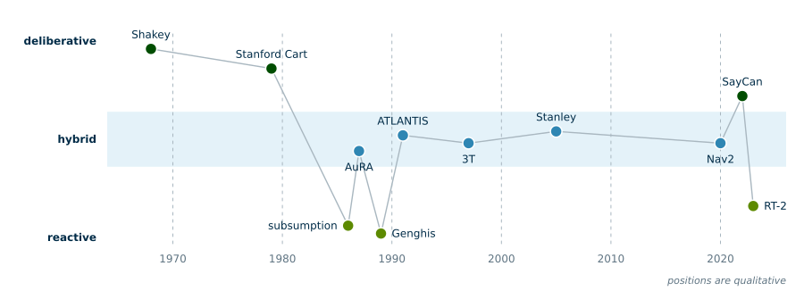

<!-- end_slide -->

Summary
=======

```faqe:table
variant = "comparison"
columns = ["Approach", "Idea", "Strong at", "Weak at"]

[[rows]]
cells = ["Deliberative", "sense → plan → act", "long-horizon, optimal plans", "slow, blind while acting"]

[[rows]]
cells = ["Reactive", "parallel sensor-to-actuator behaviours", "fast and robust", "no memory, no foresight"]

[[rows]]
cells = ["Hybrid", "controller + sequencer + deliberator", "both, each at its own rate", "more parts to integrate"]
tones = ["neutral", "neutral", "positive", "neutral"]

[[rows]]
cells = ["State machine", "states and transitions", "small sequential tasks", "explodes with interrupts"]

[[rows]]
cells = ["Behaviour tree", "a ticked tree of conditions and actions", "reactive, modular sequencing", "overkill for tiny tasks"]
```

<!-- end_slide -->

Design it: a greenhouse harvester
=================================

<!-- column_layout: [1, 1] -->

<!-- column: 0 -->

**SWEEPER**, an EU project coordinated by WUR, harvested sweet peppers in a commercial greenhouse (Arad et al., 2020):

* a 6-DOF arm with a cutting tool
* an RGB-D camera
* a battery platform that drives on the heating pipes
* about **24 s per fruit** in a four-week trial

<!-- column: 1 -->

**In groups, 10 minutes:**

1. List the **skills**: the controller layer
2. What does the **sequencer** decide?
3. What needs a **planner**?
4. Sketch the behaviour tree for *harvest one fruit*. Where does it need RUNNING?

<!-- reset_layout -->

<!-- end_slide -->

Your turn
=========

<!-- column_layout: [1, 1] -->

<!-- column: 0 -->

1. Notebook *t08_state_machine*: build an FSM step by step
2. Webots assignment: *t08_state_machine_webots_assignment.pdf* with *t08_webots.zip*

<!-- new_line -->

Start from the transition table, not the code. If every row of the table is there, the code almost writes itself.

<!-- column: 1 -->

[Expected behaviour](robot-architectures/expected-behaviour.mp4)

<!-- reset_layout -->

<!-- end_slide -->

Read more
=========

<!-- column_layout: [1, 1] -->

<!-- column: 0 -->

* Kortenkamp, Simmons & Brugali (2016). Robotic systems architectures and programming. *Springer Handbook of Robotics*, 283–306.
* Murphy (2019). *Introduction to AI Robotics*, 2nd ed. MIT Press.
* Brooks (1986). A robust layered control system for a mobile robot. *IEEE J. Robotics and Automation* 2(1).
* Arkin (1998). *Behavior-Based Robotics*. MIT Press.
* Gat (1998). On three-layer architectures. *Artificial Intelligence and Mobile Robots*, 195–210.
* Nilsson (1984). *Shakey the Robot*. SRI Technical Note 323.

<!-- column: 1 -->

* Colledanchise & Ögren (2018). *Behavior Trees in Robotics and AI*. CRC Press.
* Macenski et al. (2020). The Marathon 2: a navigation system. *IROS*.
* Iovino et al. (2023). Programming effort of behavior trees and finite state machines. *ICRA*.
* Ligot et al. (2020). Automatic modular design of robot swarms using behavior trees. *PeerJ CS*.
* Ahn et al. (2022). Do as I can, not as I say. *CoRL*.
* Arad et al. (2020). Development of a sweet pepper harvesting robot. *J. Field Robotics*.

<!-- reset_layout -->
