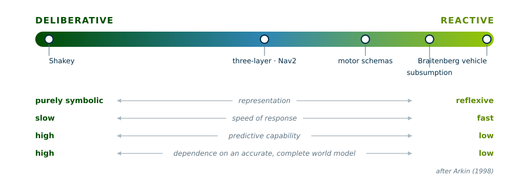
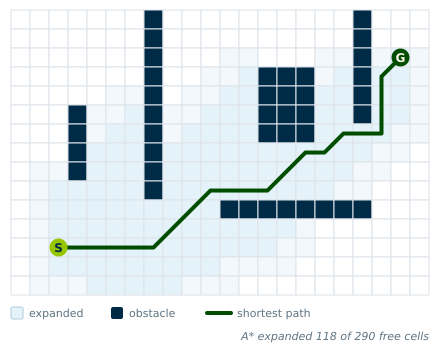
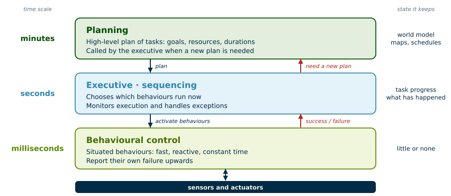
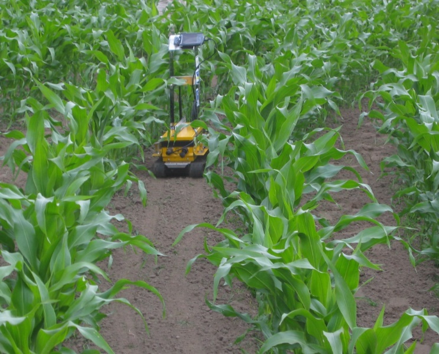
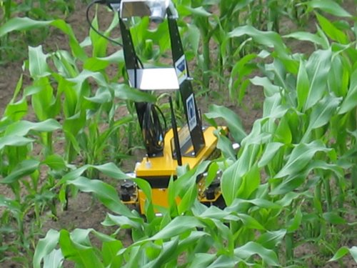

Today
=====

A robot has to **sense**, **think** and **act**, all the time, in a world that keeps changing. How do we organise the software that does this?

```faqe:grid
columns = 3
variant = "cards"

[[items]]
eyebrow = "1 · The problem"
title = "What is a robot architecture?"
body = "And why robots need a different kind of software design"
tone = "accent"

[[items]]
eyebrow = "2 · Three answers"
title = "Think first, act first, or both"
body = "Deliberative, reactive and layered architectures"
tone = "neutral"

[[items]]
eyebrow = "3 · The tool"
title = "Finite state machines"
body = "How to write the layer that decides what the robot does next"
tone = "positive"
```

<!-- new_lines: 2 -->

*Kortenkamp, D., Simmons, R., & Brugali, D. (2016). Robotic systems architectures and programming. Springer handbook of robotics, 283-306*

<!-- end_slide -->

<!-- jump_to_middle -->

The problem
===========

What is a robot architecture, and why is it hard?


<!-- end_slide -->

What is a robot architecture?
=============================

* How a system is **divided into subsystems**, and how those subsystems **interact**
* **Structure**: how the overall system is decomposed
* **Style**: how the components communicate

```faqe:graph
caption = "Structure: the boxes. Style: the arrows between them."
columns = 7
rows = 3

[[nodes]]
id = "gps"
title = "GPS/GNSS"
column = 1
row = 1
tone = "accent"

[[nodes]]
id = "distance"
title = "Distance sensor"
column = 1
row = 3
tone = "accent"

[[nodes]]
id = "follow"
title = "Follow path"
column = 3
row = 1

[[nodes]]
id = "avoid"
title = "Avoid obstacles"
column = 3
row = 3

[[nodes]]
id = "coordinate"
title = "Coordinate motion"
column = 5
row = 2

[[nodes]]
id = "left"
title = "Left motor"
column = 7
row = 1
tone = "warning"

[[nodes]]
id = "right"
title = "Right motor"
column = 7
row = 3
tone = "warning"

[[edges]]
from = "gps"
to = "follow"

[[edges]]
from = "distance"
to = "avoid"

[[edges]]
from = "follow"
to = "coordinate"

[[edges]]
from = "avoid"
to = "coordinate"

[[edges]]
from = "coordinate"
to = "left"

[[edges]]
from = "coordinate"
to = "right"
```

<!-- end_slide -->

Why robots are different
========================

Robots interact in **real time** with an uncertain, often dynamic, environment:

```faqe:grid
columns = 3
variant = "cards"

[[items]]
title = "Controlling sensors and actuators"
body = "Read every sensor and command every motor, on time, every cycle."
tone = "neutral"

[[items]]
title = "Responding to events"
body = "A person steps into the row, a wheel slips, the row ends."
tone = "warning"

[[items]]
title = "Dealing with uncertainty"
body = "Noisy sensors, imperfect maps, and a world that keeps changing."
tone = "negative"
```

<!-- new_line -->

A late answer is a wrong answer: at 1 m/s, 100 ms of thinking is 10 cm of driving.

<!-- end_slide -->

Many time scales, many behaviours
=================================

<!-- column_layout: [1, 1] -->

<!-- column: 0 -->

* Respond at **varying time scales**: reflexes in milliseconds, plans in minutes

<!-- column: 1 -->

* **Coordinate** behaviours such as path planning, navigation and obstacle avoidance, in sequence or in parallel

<!-- reset_layout -->


<!-- end_slide -->

Divide and conquer
==================

<!-- column_layout: [1, 1] -->

<!-- column: 0 -->

* **Modular decomposition**: split the system into simpler, largely independent pieces
* Often **hierarchical**
  * Modules build on top of others
  * Each layer is a different level of abstraction
  * *Task decomposition*: harvesting = reach + detach + …
  * *Temporal decomposition*: a sequence of actions

<!-- new_line -->

The question is **how** to split it. There are three classic answers.

<!-- column: 1 -->

```faqe:graph
caption = "Top-down: task decomposition. Left to right: temporal decomposition."
description = "Harvesting splits into detect, reach, detach and place, done in that order."
columns = 4
rows = 2

[[nodes]]
id = "harvest"
title = "harvest a fruit"
column = 2
row = 1
tone = "accent"

[[nodes]]
id = "detect"
title = "detect"
column = 1
row = 2
tone = "neutral"

[[nodes]]
id = "reach"
title = "reach"
column = 2
row = 2
tone = "positive"

[[nodes]]
id = "detach"
title = "detach"
column = 3
row = 2
tone = "positive"

[[nodes]]
id = "place"
title = "place"
column = 4
row = 2
tone = "neutral"

[[edges]]
from = "harvest"
to = "detect"

[[edges]]
from = "harvest"
to = "reach"

[[edges]]
from = "harvest"
to = "detach"

[[edges]]
from = "harvest"
to = "place"
```

<!-- reset_layout -->

<!-- end_slide -->

<!-- jump_to_middle -->

Three answers
=============

Think first, act first, or do both


<!-- end_slide -->

Two types of robotic responses
==============================

Every architecture sits somewhere between two extremes: **deliberate** (think, then act) and **react** (act on what you sense, right now).



<!-- end_slide -->

Think first: Shakey and sense-plan-act
======================================

<!-- column_layout: [3, 2] -->

<!-- column: 0 -->

* Shakey (SRI, late 1960s): the first robot that reasoned about its own actions
* Sensors: camera, rangefinder, bump sensors. Actuators: differential drive
* Decomposition: **sensing, planning, execution**, one after the other

```faqe:graph
description = "Sense feeds plan, which feeds act."
columns = 3
rows = 1

[[nodes]]
id = "sense"
title = "sense"
column = 1
row = 1
tone = "neutral"

[[nodes]]
id = "plan"
title = "plan"
column = 2
row = 1
tone = "accent"

[[nodes]]
id = "act"
title = "act"
column = 3
row = 1
tone = "positive"

[[edges]]
from = "sense"
to = "plan"

[[edges]]
from = "plan"
to = "act"
```

<!-- column: 1 -->


<!-- reset_layout -->

*Photo: SRI International, CC BY-SA 3.0, via Wikimedia Commons*

<!-- end_slide -->

Think first: plan on a world model
==================================

<!-- column_layout: [1, 1] -->

<!-- column: 0 -->

* Combine all sensor data into one **world model**
* A **planner** searches the model for the best sequence of actions
* Example: **A\*** on a grid map, invented for Shakey (Hart, Nilsson & Raphael, 1968)
* Then execute the plan, step by step

<!-- new_line -->

Optimal, predictable, easy to reason about, **if** the model is right.

<!-- column: 1 -->



<!-- reset_layout -->

<!-- end_slide -->

Think first: the downside
=========================

* Planning takes a **long time**, and the robot is **blocked** while it waits
* Executing a plan without sensing is **dangerous in a dynamic world**


<!-- end_slide -->

Act first: slice by behaviour
=============================


Brooks (1986) turned the diagram around: instead of one pipeline of functions, many **behaviours**, each a complete path from sensors to actuators, all running at once.

<!-- end_slide -->

Act first: subsumption
======================

```faqe:grid
columns = 4
variant = "compact"

[[items]]
title = "Decompose"
body = "The complete behaviour into **sub-behaviours**, each connecting sensors to actuators"
tone = "neutral"

[[items]]
title = "Layers"
body = "Organised into a **hierarchy of layers**"
tone = "accent"

[[items]]
title = "Arbitration"
body = "Higher layers **override** the signals of lower ones: priorities"
tone = "warning"

[[items]]
title = "Parallel"
body = "All layers **work at the same time**"
tone = "positive"
```


<!-- end_slide -->

Act first: motor schemas
========================

<!-- column_layout: [2, 3] -->

<!-- column: 0 -->

* Arkin (1989): every behaviour outputs a **vector**
  * *move-to-goal* pulls towards the goal
  * *avoid-obstacle* pushes away, harder when closer
* The robot follows the **sum**
* Subsumption **picks** one behaviour; motor schemas **blend** them all

<!-- column: 1 -->


<!-- reset_layout -->

<!-- end_slide -->

Act first: gains and losses
===========================

```faqe:grid
columns = 2
variant = "cards"

[[items]]
title = "What we gain"
tone = "positive"
bullets = ["Responds within milliseconds", "No world model to keep up to date", "Robust: behaviours fail independently", "The robot stops for a person, every time"]

[[items]]
title = "What we lose"
tone = "negative"
bullets = ["No memory: which rows are already done?", "No foresight: when should it go and charge?", "Hard to predict and debug: behaviour emerges", "Hard to build for complex tasks"]
```

<!-- end_slide -->

Do both: three layers
=====================

The **three-layer architecture** (Firby; 3T; Gat, 1998): a reactive layer at the bottom, a planner at the top, and an executive in between.



<!-- end_slide -->

Do both: the executive layer
============================

<!-- column_layout: [1, 1] -->

<!-- column: 0 -->

* Not all behaviours should be active at the same time
* The executive **chooses which behaviours run now**
* It turns the plan into a **sequence** of behaviours
* It watches for **events** and avoids conflicts

<!-- new_line -->

**How do we write it?** Very often as a *finite state machine*.

<!-- column: 1 -->

```faqe:graph
description = "The executive turns the plan into behaviours: move to room 12, release mail, move to room 14."
columns = 1
rows = 4

[[nodes]]
id = "plan"
title = "plan: rooms 12, 14"
column = 1
row = 1
tone = "accent"

[[nodes]]
id = "move12"
title = "move to room 12"
column = 1
row = 2
tone = "positive"

[[nodes]]
id = "release"
title = "release mail"
column = 1
row = 3
tone = "warning"

[[nodes]]
id = "move14"
title = "move to room 14"
column = 1
row = 4
tone = "positive"

[[edges]]
from = "plan"
to = "move12"

[[edges]]
from = "move12"
to = "release"
label = "arrived"

[[edges]]
from = "release"
to = "move14"
label = "released"
```

<!-- reset_layout -->

<!-- end_slide -->

Do both: still used today
=========================


The ROS 2 navigation stack, Nav2, has the same three layers (Macenski et al., 2020).

<!-- end_slide -->

Three answers compared
======================

```faqe:table
variant = "comparison"
columns = ["Approach", "Idea", "Strong at", "Weak at"]

[[rows]]
cells = ["Think first · deliberative", "sense → plan → act", "long-horizon, optimal plans", "slow, blind while acting"]
tones = ["neutral", "neutral", "positive", "negative"]

[[rows]]
cells = ["Act first · reactive", "parallel behaviours, sensors to actuators", "fast and robust", "no memory, no foresight"]
tones = ["neutral", "neutral", "positive", "negative"]

[[rows]]
cells = ["Do both · layered", "behaviours + executive + planner", "each job at its own pace", "more parts to integrate"]
tones = ["neutral", "neutral", "positive", "warning"]
```

<!-- new_line -->

Most real robots are layered. The rest of this lecture is about the middle layer: the executive.

<!-- end_slide -->

<!-- jump_to_middle -->

Finite state machines
=====================

Writing the layer that decides what the robot does next


<!-- end_slide -->

Finite state machine (FSM)
==========================

<!-- column_layout: [1, 1] -->

<!-- column: 0 -->

* A number of **states**, each performing a well-defined function in a specific situation
* **Events**, changes in the robot's situation, cause a **transition** from one state to another
* There is always exactly **one state active**
* The **FSM diagram** shows the states and transitions

<!-- column: 1 -->


<!-- reset_layout -->

<!-- end_slide -->

One state, many transitions
===========================

A state can have several transitions. Here the button can also **stop** the door halfway.

<!-- column_layout: [1, 1] -->

<!-- column: 0 -->


<!-- column: 1 -->


<!-- reset_layout -->

<!-- end_slide -->

A field robot: CropScout
========================

<!-- column_layout: [1, 1] -->

<!-- column: 0 -->



<!-- column: 1 -->



<!-- reset_layout -->

Its job: drive through a field, row after row.

<!-- end_slide -->

CropScout as a state machine
============================

<!-- column_layout: [1, 1] -->

<!-- column: 0 -->

* Three behaviours, so three states:
  * **Move to start of row**
  * **Navigate through the row**
  * **Make a headland turn**


<!-- column: 1 -->

What does the FSM diagram look like?

<!-- pause -->


<!-- reset_layout -->

<!-- end_slide -->

From diagram to table
=====================

```faqe:table
caption = "Every arrow in the diagram is one row. A missing row is a missing transition."
variant = "striped"
columns = ["State", "Event", "Next state", "Action"]

[[rows]]
cells = ["Move to start of row", "not at start", "Move to start of row", "drive towards the row start"]
tones = ["neutral", "muted", "neutral", "positive"]

[[rows]]
cells = ["Move to start of row", "at start", "Navigate through row", "—"]
tones = ["neutral", "warning", "accent", "muted"]

[[rows]]
cells = ["Navigate through row", "not at end", "Navigate through row", "follow the row"]
tones = ["neutral", "muted", "neutral", "positive"]

[[rows]]
cells = ["Navigate through row", "at end", "Make headland turn", "remember the heading"]
tones = ["neutral", "warning", "accent", "positive"]

[[rows]]
cells = ["Make headland turn", "< 180°", "Make headland turn", "keep turning"]
tones = ["neutral", "muted", "neutral", "positive"]

[[rows]]
cells = ["Make headland turn", "≥ 180°", "Move to start of row", "—"]
tones = ["neutral", "warning", "accent", "muted"]
```

<!-- end_slide -->

Four rules for implementing an FSM
==================================

```faqe:grid
columns = 2
variant = "cards"

[[items]]
eyebrow = "1"
title = "One state at a time"
body = "Exactly one state is active. Keep it in a single variable."
tone = "accent"

[[items]]
eyebrow = "2"
title = "Events first, then act"
body = "Every cycle: read the sensors, check the transitions of the current state, then run its behaviour."
tone = "positive"

[[items]]
eyebrow = "3"
title = "Set up on entry"
body = "Do set-up once when entering a state, such as storing the heading at the start of a headland turn."
tone = "warning"

[[items]]
eyebrow = "4"
title = "Test state by state"
body = "Start the robot in one state, check its behaviour, then check every transition out of it."
tone = "neutral"
```

<!-- end_slide -->

Time to work with FSM yourself
==============================

<!-- column_layout: [1, 1] -->

<!-- column: 0 -->

1. Notebook *t08_state_machine*
2. Webots assignment: *t08_state_machine_webots_assignment.pdf* and *t08_webots.zip*

<!-- new_line -->

Draw the diagram and write the table first. The code follows from them.

<!-- column: 1 -->

[Expected behaviour](robot-architectures/expected-behaviour.mp4)

<!-- reset_layout -->
