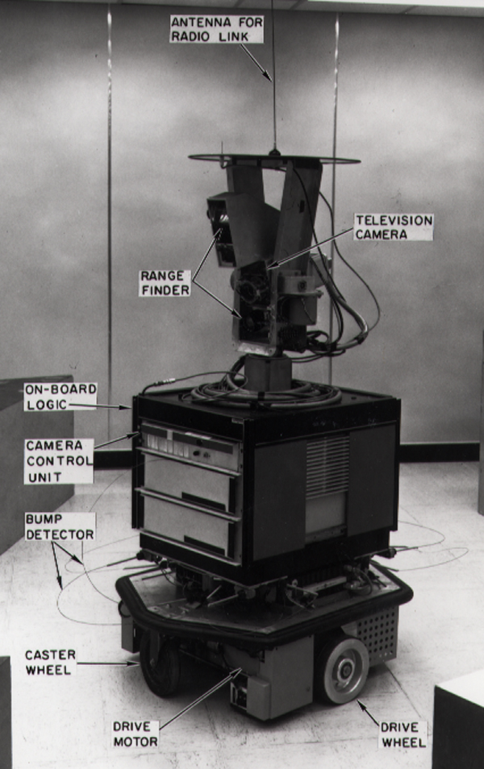
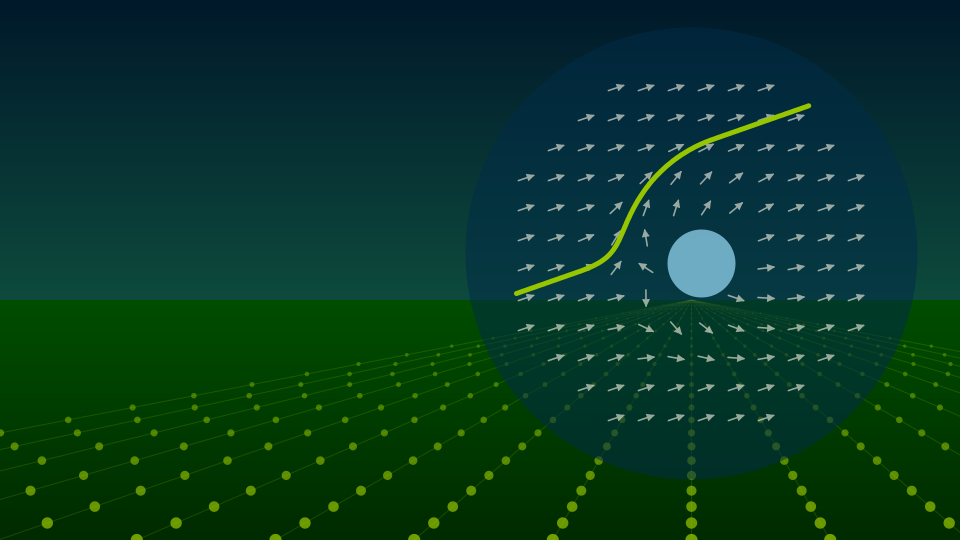
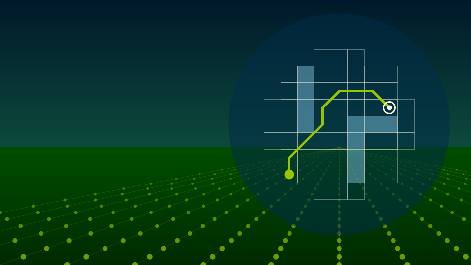
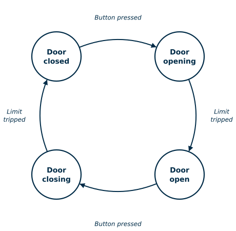
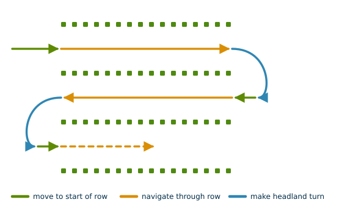
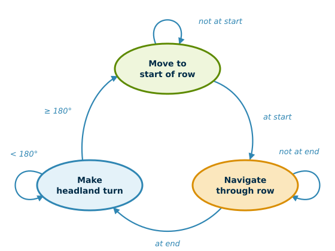

Outline
=======

```faqe:grid
columns = 3
variant = "cards"

[[items]]
eyebrow = "1"
title = "Robot architectures"
body = "What they are, why robots need them, and a short history"
tone = "accent"

[[items]]
eyebrow = "2"
title = "Different paradigms"
body = "Deliberative, reactive, subsumption and layered architectures"
tone = "neutral"

[[items]]
eyebrow = "3"
title = "Finite state machines"
body = "States, events and transitions, the CropScout example, and your assignment"
tone = "positive"
```

<!-- new_lines: 2 -->

*Kortenkamp, D., Simmons, R., & Brugali, D. (2016). Robotic systems architectures and programming. Springer handbook of robotics, 283-306*

<!-- end_slide -->

<!-- jump_to_middle -->

Robot architectures
===================

How a robot is divided into parts, and how the parts work together


<!-- end_slide -->

What is robot architecture
==========================

<!-- column_layout: [3, 2] -->

<!-- column: 0 -->

* It refers to how a system is **divided into subsystems** and how those subsystems interact. E.g.:
  * **Different processes**: sensing, thinking, acting
  * Multiple behaviours
* Deals with the **coordination of these behaviours**

<!-- new_line -->

* It is distinguished from other software architectures because of the special needs of robot systems.

<!-- column: 1 -->

```faqe:graph
description = "Sensing feeds thinking, which commands acting."
columns = 1
rows = 3

[[nodes]]
id = "sense"
title = "sensing"
subtitle = "camera, lidar, GNSS"
column = 1
row = 1
tone = "neutral"

[[nodes]]
id = "think"
title = "thinking"
subtitle = "decide what to do"
column = 1
row = 2
tone = "accent"

[[nodes]]
id = "act"
title = "acting"
subtitle = "wheels, arm, gripper"
column = 1
row = 3
tone = "positive"

[[edges]]
from = "sense"
to = "think"

[[edges]]
from = "think"
to = "act"
```

<!-- reset_layout -->

<!-- end_slide -->

What are the special needs of robot architecture
================================================

Interaction in **real-time**, with an uncertain, often dynamic, environment:

```faqe:grid
columns = 3
variant = "cards"

[[items]]
title = "Controlling sensors and actuators"
body = "Read every sensor and command every motor, on time, every cycle."
tone = "neutral"

[[items]]
title = "Responding to events in the environment"
body = "A person steps into the row, a wheel slips, the row ends."
tone = "warning"

[[items]]
title = "Dealing with uncertainty"
body = "Noisy sensors, imperfect maps, and a world that keeps changing."
tone = "negative"
```

<!-- end_slide -->

What are the special needs of robot architecture
================================================

<!-- column_layout: [1, 1] -->

<!-- column: 0 -->

* Responding at **varying temporal scopes**
  * Behaviour-based reflexes
  * Deliberative long-term planning

<!-- column: 1 -->

* **Coordinating** different behaviours
  * E.g. path planning, navigation, obstacle avoidance
  * Sequential or in parallel

<!-- reset_layout -->


<!-- end_slide -->

Modularity and hierarchy
========================

<!-- column_layout: [1, 1] -->

<!-- column: 0 -->

* **Modular decomposition** of the overall system in simpler, largely independent pieces
* Often **hierarchical**
  * Modules build on top of others
  * Different layers in the hierarchy: different levels of abstraction
  * *Task decomposition*: e.g. harvesting = reaching + detach + …
  * *Temporal decomposition*: sequence of actions

<!-- column: 1 -->

```faqe:graph
caption = "Top-down: task decomposition. Left to right: temporal decomposition."
description = "Harvesting splits into detect fruit, reach, detach and place in crate, done in that order."
columns = 4
rows = 2

[[nodes]]
id = "harvest"
title = "harvest a fruit"
column = 2
row = 1
tone = "accent"

[[nodes]]
id = "detect"
title = "detect"
column = 1
row = 2
tone = "neutral"

[[nodes]]
id = "reach"
title = "reach"
column = 2
row = 2
tone = "positive"

[[nodes]]
id = "detach"
title = "detach"
column = 3
row = 2
tone = "positive"

[[nodes]]
id = "place"
title = "place"
column = 4
row = 2
tone = "neutral"

[[edges]]
from = "harvest"
to = "detect"

[[edges]]
from = "harvest"
to = "reach"

[[edges]]
from = "harvest"
to = "detach"

[[edges]]
from = "harvest"
to = "place"
```

<!-- reset_layout -->

<!-- end_slide -->

Robot architecture: structure and style
=======================================

<!-- column_layout: [1, 1] -->

<!-- column: 0 -->

* **Structure**: how to decompose the overall system

<!-- column: 1 -->

* **Style**: how the components interact and communicate

<!-- reset_layout -->

```faqe:graph
columns = 7
rows = 3

[[nodes]]
id = "gps"
title = "GPS/GNSS"
column = 1
row = 1
tone = "accent"

[[nodes]]
id = "distance"
title = "Distance sensor"
column = 1
row = 3
tone = "accent"

[[nodes]]
id = "follow"
title = "Follow path"
column = 3
row = 1

[[nodes]]
id = "avoid"
title = "Avoid obstacles"
column = 3
row = 3

[[nodes]]
id = "coordinate"
title = "Coordinate motion"
column = 5
row = 2

[[nodes]]
id = "left"
title = "Left motor"
column = 7
row = 1
tone = "warning"

[[nodes]]
id = "right"
title = "Right motor"
column = 7
row = 3
tone = "warning"

[[edges]]
from = "gps"
to = "follow"

[[edges]]
from = "distance"
to = "avoid"

[[edges]]
from = "follow"
to = "coordinate"

[[edges]]
from = "avoid"
to = "coordinate"

[[edges]]
from = "coordinate"
to = "left"

[[edges]]
from = "coordinate"
to = "right"
```

<!-- end_slide -->

History: Shakey robot at SRI (late 1960s)
=========================================

<!-- column_layout: [3, 2] -->

<!-- column: 0 -->

* Sensors: camera, a rangefinder, and bump sensors
* Actuators: differential drive
* Decomposition: sensing, planning, and execution
* The **sense-think-act** paradigm
* Its planning work gave us **STRIPS** and the **A\*** search algorithm

```faqe:graph
description = "Sense feeds plan, which feeds act."
columns = 3
rows = 1

[[nodes]]
id = "sense"
title = "sense"
column = 1
row = 1
tone = "neutral"

[[nodes]]
id = "plan"
title = "plan"
column = 2
row = 1
tone = "accent"

[[nodes]]
id = "act"
title = "act"
column = 3
row = 1
tone = "positive"

[[edges]]
from = "sense"
to = "plan"

[[edges]]
from = "plan"
to = "act"
```

<!-- column: 1 -->



<!-- reset_layout -->

*Photo: SRI International, CC BY-SA 3.0, via Wikimedia Commons*

<!-- end_slide -->

History: downside of SPA paradigm
=================================

* Limitations of the Sense-Plan-Act paradigm:
  * Planning took a **long time**, and the robot would be **blocked**, waiting for planning to complete
  * Execution of a plan without involving sensing was **dangerous in a dynamic world**


<!-- end_slide -->

History: reactive behaviour-based paradigms
===========================================

* Focus on reactive planners, real-time interaction with the environment
  * Rodney Brooks, Ronald Arkin, …
* Example: office mail delivery robot

```faqe:graph
columns = 5
rows = 2

[[nodes]]
id = "camera"
title = "Camera"
column = 1
row = 1
tone = "accent"

[[nodes]]
id = "detect"
title = "Detect room nr"
column = 2
row = 1

[[nodes]]
id = "move"
title = "Move to room"
column = 3
row = 1

[[nodes]]
id = "deliver"
title = "Deliver mail"
column = 4
row = 1

[[nodes]]
id = "release"
title = "Release mail"
column = 5
row = 1
tone = "warning"

[[nodes]]
id = "wander"
title = "Wander"
column = 2
row = 2

[[nodes]]
id = "subsume"
title = "Subsume"
column = 3
row = 2
tone = "muted"

[[nodes]]
id = "drive"
title = "Drive"
column = 5
row = 2
tone = "warning"

[[edges]]
from = "camera"
to = "detect"

[[edges]]
from = "detect"
to = "move"

[[edges]]
from = "move"
to = "deliver"

[[edges]]
from = "deliver"
to = "release"

[[edges]]
from = "move"
to = "subsume"

[[edges]]
from = "wander"
to = "subsume"

[[edges]]
from = "subsume"
to = "drive"
```

* Downside: difficult to construct for more complex behaviours

<!-- end_slide -->

<!-- jump_to_middle -->

Different paradigms
===================

Deliberative, reactive and layered



<!-- end_slide -->

Two types of robotic responses
==============================


<!-- end_slide -->

Deliberative and reactive planning
==================================


Left: **deliberative**, the sense-think-act paradigm. Right: **reactive**, the behaviour-based approach (Brooks, 1986).

<!-- end_slide -->

Deliberative planning
=====================

<!-- column_layout: [1, 1] -->

<!-- column: 0 -->

* Sense-think-act paradigm
* One **world model**, one **planner**
* The planner searches the model for the best sequence of actions, e.g. **A\*** on a grid map
* Optimal when the model is right, but slow and blind when the world changes

<!-- column: 1 -->


<!-- reset_layout -->

<!-- end_slide -->

Reactive planning
=================

<!-- column_layout: [2, 3] -->

<!-- column: 0 -->

* Behaviour-based approach
* Each behaviour maps **sensors directly to actions**
* Behaviours run **in parallel** and their outputs are combined
* Arkin's **motor schemas**: every behaviour outputs a vector and the robot follows the sum
* No world model: fast, but it can get stuck in local minima

<!-- column: 1 -->


<!-- reset_layout -->

<!-- end_slide -->

Subsumption
===========

```faqe:grid
columns = 4
variant = "compact"

[[items]]
title = "Decompose"
body = "The complete behaviour into **sub-behaviours**, each connecting sensors to actuators"
tone = "neutral"

[[items]]
title = "Layers"
body = "Organised into a **hierarchy of layers**"
tone = "accent"

[[items]]
title = "Arbitration"
body = "Higher-level behaviours **override** the signals of lower-level ones: priorities"
tone = "warning"

[[items]]
title = "Parallel"
body = "The layers **work in parallel**"
tone = "positive"
```


<!-- end_slide -->

Layered robot control architectures
===================================

The **three-layer architecture**: a hybrid reactive/deliberative robot architecture (R. James Firby). The **3T architecture**: behaviour control, sequencing/coordination, and planning.


<!-- end_slide -->

Layered robot control architectures
===================================

<!-- column_layout: [1, 1] -->

<!-- column: 0 -->

* The **executive layer**
  * Not all low-level behaviours should be active at the same time
  * Coordinating behaviours
  * Achieving high-level tasks
  * Avoiding conflicts

<!-- column: 1 -->

```faqe:graph
description = "The executive turns the plan into behaviours: move to room 12, release mail, move to room 14."
columns = 1
rows = 4

[[nodes]]
id = "plan"
title = "plan: rooms 12, 14"
column = 1
row = 1
tone = "accent"

[[nodes]]
id = "move12"
title = "move to room 12"
column = 1
row = 2
tone = "positive"

[[nodes]]
id = "release"
title = "release mail"
column = 1
row = 3
tone = "warning"

[[nodes]]
id = "move14"
title = "move to room 14"
column = 1
row = 4
tone = "positive"

[[edges]]
from = "plan"
to = "move12"

[[edges]]
from = "move12"
to = "release"
label = "arrived"

[[edges]]
from = "release"
to = "move14"
label = "released"
```

<!-- reset_layout -->

<!-- end_slide -->

Layered architectures today: Nav2
=================================


The ROS 2 navigation stack follows the same three layers (Macenski et al., 2020).

<!-- end_slide -->

<!-- skip_slide -->

<!-- jump_to_middle -->

Example
=======



<!-- end_slide -->

<!-- skip_slide -->

Behavioural-control layer
=========================

<!-- column_layout: [1, 1] -->

<!-- column: 0 -->

* **Situated behaviours**
  * Active in specific situations
* **Cognizant failure**
  * Behaviours should communicate failure to the executive layer
* **Constraints**
  * Fast, reactive, high frequency, constant time
  * Only a small world model

<!-- column: 1 -->

```faqe:grid
title = "Simple low-level behaviours"
columns = 2
variant = "compact"

[[items]]
title = "move to room"
tone = "positive"

[[items]]
title = "avoid obstacles"
tone = "warning"

[[items]]
title = "detect room number"
tone = "neutral"

[[items]]
title = "release mail"
tone = "positive"

[[items]]
title = "wander"
tone = "muted"

[[items]]
title = "dock and charge"
tone = "neutral"
```

<!-- reset_layout -->

<!-- end_slide -->

<!-- skip_slide -->

Executive layer
===============

<!-- column_layout: [1, 1] -->

<!-- column: 0 -->

* Role of the executive layer
  * Translating high-level plans (goals) into low-level behaviours
  * Coordinating low-level behaviours
  * Monitoring execution, handling exceptions
  * Error recovery
* The executive layer describes how to achieve tasks

<!-- column: 1 -->

```faqe:graph
description = "Deliver mail splits into move to room, release mail and return to base."
columns = 3
rows = 2

[[nodes]]
id = "deliver"
title = "deliver mail"
column = 2
row = 1
tone = "accent"

[[nodes]]
id = "move"
title = "move to room"
column = 1
row = 2
tone = "positive"

[[nodes]]
id = "release"
title = "release mail"
column = 2
row = 2
tone = "positive"

[[nodes]]
id = "back"
title = "return to base"
column = 3
row = 2
tone = "positive"

[[edges]]
from = "deliver"
to = "move"

[[edges]]
from = "deliver"
to = "release"

[[edges]]
from = "deliver"
to = "back"
```

<!-- reset_layout -->

<!-- end_slide -->

<!-- skip_slide -->

Planning layer
==============

<!-- column_layout: [3, 2] -->

<!-- column: 0 -->

* Planner/scheduler
  * High-level plan of (sub)tasks
  * Including: goals, resources, duration, and constraints
* Role of the planner in the architecture
  * Planners called by the executive layer when needed
  * Planners always active, sending tasks down and monitoring progress

<!-- column: 1 -->

> **Planners**
>
> * Planning task schedules
> * Getting mail delivery information
> * Route planner
>   * Map of the building
>   * Mail recipients
>   * Capacity of the robot
>   * …

<!-- reset_layout -->

<!-- end_slide -->

<!-- jump_to_middle -->

Finite-state machine
====================

The pattern you will implement in the assignment


<!-- end_slide -->

Finite state machine (FSM)
==========================

<!-- column_layout: [1, 1] -->

<!-- column: 0 -->

* Finite state machine: a number of *states* that each performs a **well-defined function to operate the robot** in a specific situation
* *Events* that reflect a **change in the robot's situation** cause a **transition** from one state to another
* There is always **one state active**
* The **FSM diagram** provides a graphical representation of states and transitions

<!-- column: 1 -->



<!-- reset_layout -->

<!-- end_slide -->

Finite state machine: an example
================================

States can have multiple transitions to other states.

<!-- column_layout: [1, 1] -->

<!-- column: 0 -->


<!-- column: 1 -->


<!-- reset_layout -->

<!-- end_slide -->

Finite state machine: example
=============================

CropScout

<!-- column_layout: [1, 1] -->

<!-- column: 0 -->


<!-- column: 1 -->


<!-- reset_layout -->

<!-- end_slide -->

Finite state machine: example
=============================

<!-- column_layout: [1, 1] -->

<!-- column: 0 -->

* CropScout's three main behaviours/states:
  * **Move to start of row**
  * **Navigate through the row**
  * **Perform headland turn**



<!-- column: 1 -->

What does this FSM diagram look like?

<!-- pause -->



<!-- reset_layout -->

<!-- end_slide -->

From diagram to table
=====================

```faqe:table
caption = "Every arrow in the diagram is one row. A missing row is a missing transition."
variant = "striped"
columns = ["State", "Event", "Next state", "Action"]

[[rows]]
cells = ["Move to start of row", "not at start", "Move to start of row", "drive towards the row start"]
tones = ["neutral", "muted", "neutral", "positive"]

[[rows]]
cells = ["Move to start of row", "at start", "Navigate through row", "—"]
tones = ["neutral", "warning", "accent", "muted"]

[[rows]]
cells = ["Navigate through row", "not at end", "Navigate through row", "follow the row"]
tones = ["neutral", "muted", "neutral", "positive"]

[[rows]]
cells = ["Navigate through row", "at end", "Make headland turn", "remember the heading"]
tones = ["neutral", "warning", "accent", "positive"]

[[rows]]
cells = ["Make headland turn", "< 180°", "Make headland turn", "keep turning"]
tones = ["neutral", "muted", "neutral", "positive"]

[[rows]]
cells = ["Make headland turn", "≥ 180°", "Move to start of row", "—"]
tones = ["neutral", "warning", "accent", "muted"]
```

<!-- end_slide -->

From table to code
==================

<!-- column_layout: [3, 2] -->

<!-- column: 0 -->

```python
from enum import Enum
State = Enum("State", "MOVE_TO_START NAVIGATE_ROW HEADLAND_TURN")
state = State.MOVE_TO_START
while robot.step(TIME_STEP) != -1:          # one control cycle
    s = read_sensors()
    if state == State.MOVE_TO_START:
        if s.at_start:
            state = State.NAVIGATE_ROW
        else:
            drive_to_row_start(s)
    elif state == State.NAVIGATE_ROW:
        if s.at_end:
            state = State.HEADLAND_TURN
            turn_start = s.heading          # entry action
        else:
            follow_row(s)
    elif state == State.HEADLAND_TURN:
        if angle_turned(turn_start, s.heading) >= 180:
            state = State.MOVE_TO_START
        else:
            turn(s)
```

<!-- column: 1 -->

* One `state` variable: exactly one state active
* Each branch first checks its **events**, then runs its **behaviour**
* The `else` branches are the **self-loops** of the diagram
* `drive_to_row_start`, `follow_row` and `turn` are your behaviours

<!-- reset_layout -->

<!-- end_slide -->

Implementing an FSM: four rules
===============================

```faqe:grid
columns = 2
variant = "cards"

[[items]]
eyebrow = "1"
title = "One state variable"
body = "Exactly one state is active. Keep it in a single variable, for example an `Enum`."
tone = "accent"

[[items]]
eyebrow = "2"
title = "Events first, then act"
body = "Every cycle: read the sensors, check the transitions of the current state, then run its behaviour."
tone = "positive"

[[items]]
eyebrow = "3"
title = "Entry actions"
body = "Do set-up once when entering a state, such as storing the heading at the start of a headland turn."
tone = "warning"

[[items]]
eyebrow = "4"
title = "Test state by state"
body = "Start the robot in one state, check its behaviour, then check every transition out of it."
tone = "neutral"
```

<!-- end_slide -->

Time to work with FSM yourself
==============================

<!-- column_layout: [1, 1] -->

<!-- column: 0 -->

1. Notebook *t08_state_machine*
2. Webots assignment: *t08_state_machine_webots_assignment.pdf* and *t08_webots.zip*

<!-- new_line -->

Draw the diagram and write the table first. The code follows from them.

<!-- column: 1 -->

[Expected behaviour](robot-architectures/expected-behaviour.mp4)

<!-- reset_layout -->
