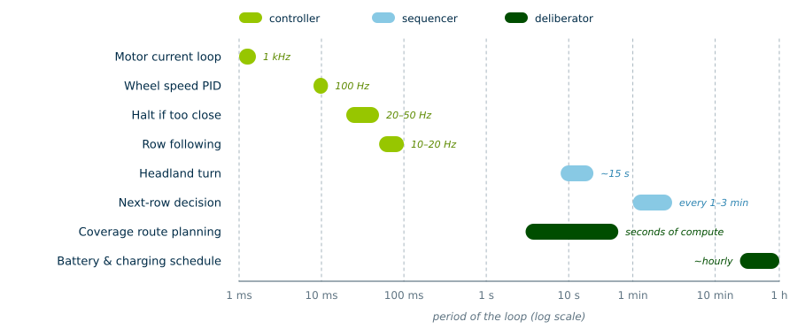
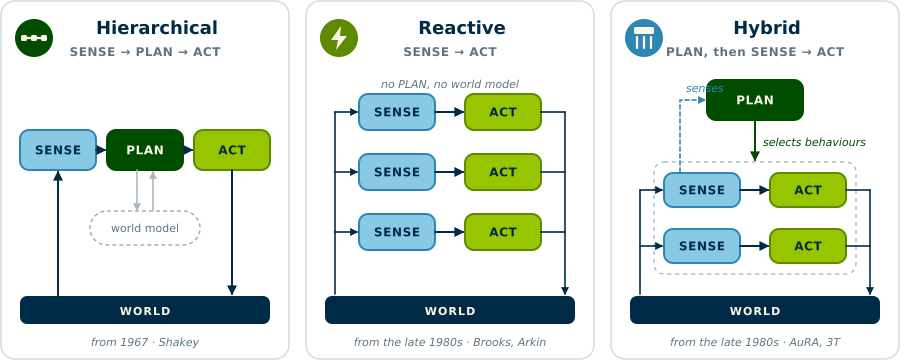
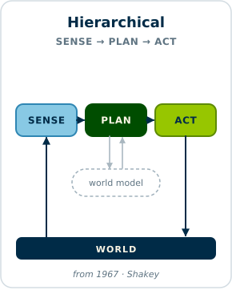
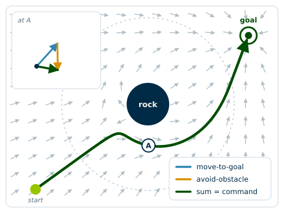
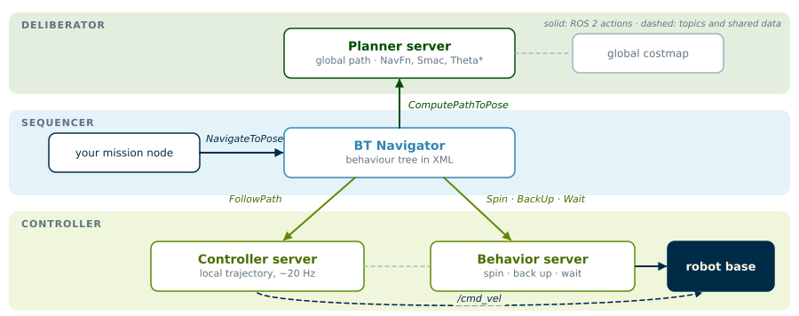
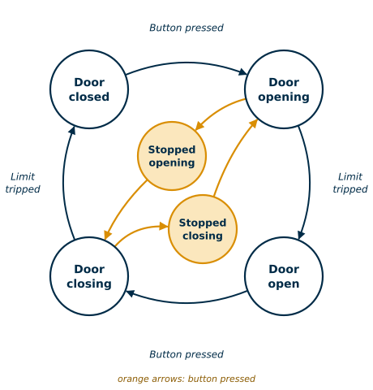
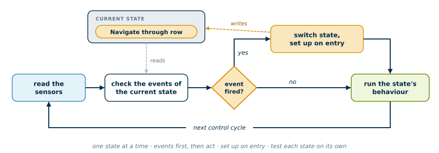

Today
=====

**How should a robot connect sensing, thinking and acting?** Four steps, from the building blocks to a state machine you program yourself.


*Main reading: Kortenkamp, Simmons & Brugali (2016), Robotic systems architectures and programming, Springer Handbook of Robotics*

<!-- end_slide -->

<!-- jump_to_middle -->

Building blocks
===============

What every robot program is made of


<!-- end_slide -->

Sense, plan, act
================

Every robot program is built from three primitives (Murphy, 2019).


<!-- end_slide -->

Architecture: structure and style
=================================

<!-- column_layout: [1, 1] -->

<!-- column: 0 -->

* **Structure**: how the system is split into components

<!-- column: 1 -->

* **Style**: how the components communicate

<!-- reset_layout -->

```faqe:graph
caption = "A robot architecture: the boxes are the structure, the arrows are the style."
columns = 7
rows = 3

[[nodes]]
id = "gps"
title = "GPS/GNSS"
subtitle = "SENSE"
column = 1
row = 1
tone = "accent"

[[nodes]]
id = "distance"
title = "Distance sensor"
subtitle = "SENSE"
column = 1
row = 3
tone = "accent"

[[nodes]]
id = "follow"
title = "Follow path"
column = 3
row = 1

[[nodes]]
id = "avoid"
title = "Avoid obstacles"
column = 3
row = 3

[[nodes]]
id = "coordinate"
title = "Coordinate motion"
column = 5
row = 2

[[nodes]]
id = "left"
title = "Left motor"
subtitle = "ACT"
column = 7
row = 1
tone = "warning"

[[nodes]]
id = "right"
title = "Right motor"
subtitle = "ACT"
column = 7
row = 3
tone = "warning"

[[edges]]
from = "gps"
to = "follow"

[[edges]]
from = "distance"
to = "avoid"

[[edges]]
from = "follow"
to = "coordinate"

[[edges]]
from = "avoid"
to = "coordinate"

[[edges]]
from = "coordinate"
to = "left"

[[edges]]
from = "coordinate"
to = "right"
```

<!-- end_slide -->

A robot runs on many time scales
================================

<!-- column_layout: [1, 1] -->

<!-- column: 0 -->

* **Real time** in an uncertain, changing world: a late answer is a wrong answer

<!-- column: 1 -->

* **Coordination**: many behaviours, in sequence or in parallel

<!-- reset_layout -->



<!-- end_slide -->

Split big tasks into smaller tasks
=================================

<!-- column_layout: [1, 1] -->

<!-- column: 0 -->

* **Modular**: simpler, largely independent pieces
* **Hierarchical**: each level more abstract than the one below
  * *Task decomposition*: harvesting = detect + reach + detach + place
  * *Temporal decomposition*: in what order

<!-- new_line -->

So how should the pieces, and the three primitives, be connected? Robotics has tried three answers.

<!-- column: 1 -->

```faqe:graph
caption = "Top-down: task decomposition. Left to right: temporal decomposition."
description = "Harvesting splits into detect, reach, detach and place, done in that order."
columns = 4
rows = 2

[[nodes]]
id = "harvest"
title = "harvest a fruit"
column = 2
row = 1
tone = "accent"

[[nodes]]
id = "detect"
title = "detect"
column = 1
row = 2
tone = "neutral"

[[nodes]]
id = "reach"
title = "reach"
column = 2
row = 2
tone = "positive"

[[nodes]]
id = "detach"
title = "detach"
column = 3
row = 2
tone = "positive"

[[nodes]]
id = "place"
title = "place"
column = 4
row = 2
tone = "neutral"

[[edges]]
from = "harvest"
to = "detect"

[[edges]]
from = "harvest"
to = "reach"

[[edges]]
from = "harvest"
to = "detach"

[[edges]]
from = "harvest"
to = "place"
```

<!-- reset_layout -->

<!-- end_slide -->

<!-- jump_to_middle -->

Three paradigms
===============

Three ways to connect sense, plan and act


<!-- end_slide -->

Three ways to connect the blocks
================================



A paradigm is defined by how the primitives are connected (Murphy, 2019). We take them one by one.

<!-- end_slide -->

Hierarchical: Shakey
====================

<!-- column_layout: [3, 2, 2] -->

<!-- column: 0 -->

* **Shakey** (SRI, late 1960s): the first robot that reasoned about its own actions
* Camera, rangefinder and bump sensors; differential drive
* Strictly in turn: **sense** the world, **plan** on a world model, **act**

<!-- column: 1 -->



<!-- column: 2 -->


<!-- reset_layout -->

*Photo: SRI International, CC BY-SA 3.0, via Wikimedia Commons*

<!-- end_slide -->

Hierarchical: plan on a world model
===================================

<!-- column_layout: [1, 1] -->

<!-- column: 0 -->

* All sensor data goes into one **world model**
* A **planner** searches the model for the best sequence of actions
* **A\*** on a grid map was invented for Shakey (Hart, Nilsson & Raphael, 1968)
* Optimal and predictable, **if** the model is right

<!-- column: 1 -->


<!-- reset_layout -->

<!-- end_slide -->

Hierarchical: the world does not wait
=====================================

* Planning takes **long**, and the robot is **blocked** while it waits
* The plan runs **without sensing**, which is dangerous in a dynamic world


<!-- end_slide -->

Reactive: cut out the planner
=============================


Brooks (1986): instead of one pipeline of functions, many **behaviours**, each a direct link from SENSE to ACT, all running at once.

<!-- end_slide -->

Reactive: subsumption layers
============================


Layers run **in parallel**. A higher layer **suppresses** (S) the command of the layer below: arbitration by priority (Brooks, 1986).

<!-- end_slide -->

Reactive: motor schemas blend behaviours
========================================

<!-- column_layout: [2, 3] -->

<!-- column: 0 -->

* Arkin (1989): every behaviour outputs a **vector**
  * *move-to-goal* pulls towards the goal
  * *avoid-obstacle* pushes away, harder when closer
* The robot follows the **sum**
* Subsumption **picks** one behaviour, motor schemas **blend** them all

<!-- column: 1 -->



<!-- reset_layout -->

<!-- end_slide -->

Reactive: fast, but short-sighted
=================================

<!-- column_layout: [2, 3] -->

<!-- column: 0 -->

* Responds in milliseconds, needs no world model
* But:
  * **No memory**: which rows are already done?
  * **No foresight**: when should it go and charge?
  * **Hard to predict**: behaviour emerges
  * **Gets stuck**: forces can cancel out

<!-- column: 1 -->


<!-- reset_layout -->

<!-- end_slide -->

Hybrid: plan on top, react below
================================


Three-layer architectures (Firby; 3T; Gat, 1998): reactive behaviours at the bottom, a planner on top, and an **executive** that connects them.

<!-- end_slide -->

Hybrid: the executive chooses what runs now
===========================================

<!-- column_layout: [1, 1] -->

<!-- column: 0 -->

* Not all behaviours should be active at the same time
* The executive turns the plan into a **sequence of behaviours**
* It switches when an **event** happens: arrived, released, blocked

<!-- new_line -->

States, events, switching: this is a **finite state machine**.

<!-- column: 1 -->

```faqe:graph
description = "The executive turns the plan into behaviours: move to room 12, release mail, move to room 14."
columns = 1
rows = 4

[[nodes]]
id = "plan"
title = "plan: rooms 12, 14"
subtitle = "from the planner"
column = 1
row = 1
tone = "accent"

[[nodes]]
id = "move12"
title = "move to room 12"
column = 1
row = 2
tone = "positive"

[[nodes]]
id = "release"
title = "release mail"
column = 1
row = 3
tone = "warning"

[[nodes]]
id = "move14"
title = "move to room 14"
column = 1
row = 4
tone = "positive"

[[edges]]
from = "plan"
to = "move12"

[[edges]]
from = "move12"
to = "release"
label = "arrived"

[[edges]]
from = "release"
to = "move14"
label = "released"
```

<!-- reset_layout -->

<!-- end_slide -->

Hybrid today: Nav2 in ROS 2
===========================



The ROS 2 navigation stack has the same three layers (Macenski et al., 2020).

<!-- end_slide -->

Where the three paradigms sit
=============================


Most robots today are **hybrid**. Next: how to program its middle layer, the executive.

<!-- end_slide -->

<!-- jump_to_middle -->

State machines
==============

Programming the executive layer


<!-- end_slide -->

A finite state machine
======================

<!-- column_layout: [1, 1] -->

<!-- column: 0 -->

* **States**: each performs one well-defined function
* **Events**: a change in the robot's situation
* **Transitions**: an event moves the machine to another state
* Always exactly **one state active**

<!-- column: 1 -->


<!-- reset_layout -->

<!-- end_slide -->

States can have several transitions
===================================

The same button can also **stop** the door halfway: two new states, four new transitions.

<!-- column_layout: [1, 1] -->

<!-- column: 0 -->


<!-- column: 1 -->



<!-- reset_layout -->

<!-- end_slide -->

Example: CropScout
==================

<!-- column_layout: [1, 1] -->

<!-- column: 0 -->


<!-- column: 1 -->


<!-- reset_layout -->

A field robot that drives through a crop, row after row.

<!-- end_slide -->

CropScout's three states
========================

<!-- column_layout: [1, 1] -->

<!-- column: 0 -->

* **Move to start of row**
* **Navigate through the row**
* **Make a headland turn**


<!-- column: 1 -->

What does the FSM look like?

<!-- pause -->


<!-- reset_layout -->

<!-- end_slide -->

From diagram to transition table
================================

<!-- column_layout: [1, 1] -->

<!-- column: 0 -->


<!-- column: 1 -->

```faqe:table
caption = "Every arrow is one row. A missing row is a missing transition."
variant = "striped"
columns = ["State", "Event", "Next state"]

[[rows]]
cells = ["Move to start", "not at start", "Move to start"]
tones = ["neutral", "muted", "neutral"]

[[rows]]
cells = ["Move to start", "at start", "Navigate row"]
tones = ["neutral", "warning", "accent"]

[[rows]]
cells = ["Navigate row", "not at end", "Navigate row"]
tones = ["neutral", "muted", "neutral"]

[[rows]]
cells = ["Navigate row", "at end", "Headland turn"]
tones = ["neutral", "warning", "accent"]

[[rows]]
cells = ["Headland turn", "< 180°", "Headland turn"]
tones = ["neutral", "muted", "neutral"]

[[rows]]
cells = ["Headland turn", "≥ 180°", "Move to start"]
tones = ["neutral", "warning", "accent"]
```

<!-- reset_layout -->

<!-- end_slide -->

How an FSM runs, cycle after cycle
==================================



<!-- end_slide -->

Your turn
=========

<!-- column_layout: [1, 1] -->

<!-- column: 0 -->

1. Notebook *t08_state_machine*
2. Webots assignment: *t08_state_machine_webots_assignment.pdf* and *t08_webots.zip*

<!-- new_line -->

Draw the diagram, write the table, then code the loop.

<!-- column: 1 -->

[Expected behaviour](robot-architectures/expected-behaviour.mp4)

<!-- reset_layout -->
