Today
=====

**How should a robot connect sensing, thinking and acting?** Four steps, from the building blocks to a state machine you program yourself.

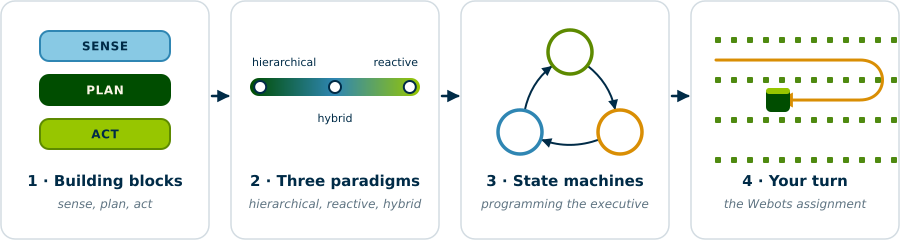

*Main reading: Kortenkamp, Simmons & Brugali (2016), Robotic systems architectures and programming, Springer Handbook of Robotics*

<!-- end_slide -->

<!-- jump_to_middle -->

Building blocks
===============

What every robot program is made of

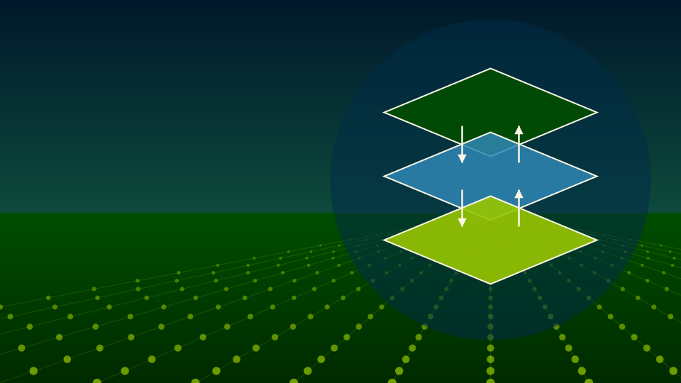

<!-- end_slide -->

Sense, plan, act
================

Every robot program is built from three primitives (Murphy, 2019).

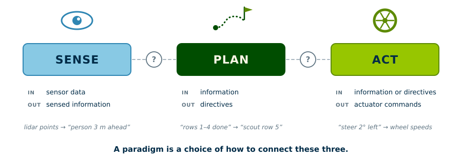

<!-- end_slide -->

Two big ideas
=============

How do we put SENSE, PLAN and ACT together? Two ideas: the **architecture**, how the program is built (Kortenkamp et al., 2016), and the **paradigm**, how SENSE, PLAN and ACT are wired (Murphy, 2019).

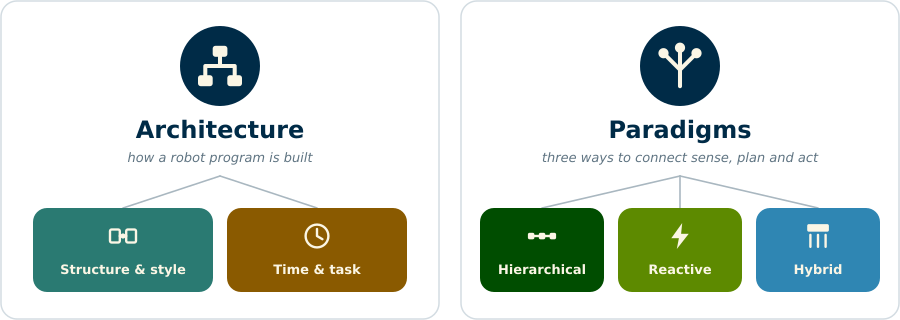

<!-- end_slide -->

<!-- jump_to_middle -->

Architecture
============

How a robot program is built

<!-- end_slide -->

Structure & style
=================

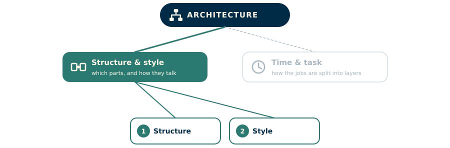

<!-- end_slide -->

Structure: which parts, and which are connected
===============================================

**Structure** is the boxes and the lines. The same sensors and motors can be wired very differently, and that choice is what the three paradigms will disagree about.

<!-- end_slide -->

Style: how connected parts talk
===============================

**Style** is what a line means: how data travels along a connection, and above all **who waits for whom**.

<!-- end_slide -->

Time & task
===========

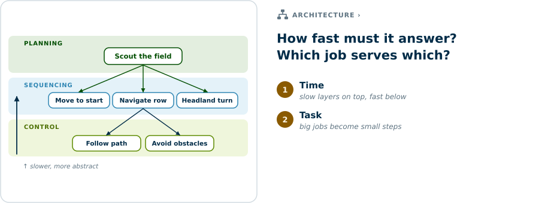

<!-- end_slide -->

A robot does many jobs at once
==============================

So which parts should the program have? Look at what the robot does: many **jobs at the same time**, some answering within milliseconds, others with minutes to think.

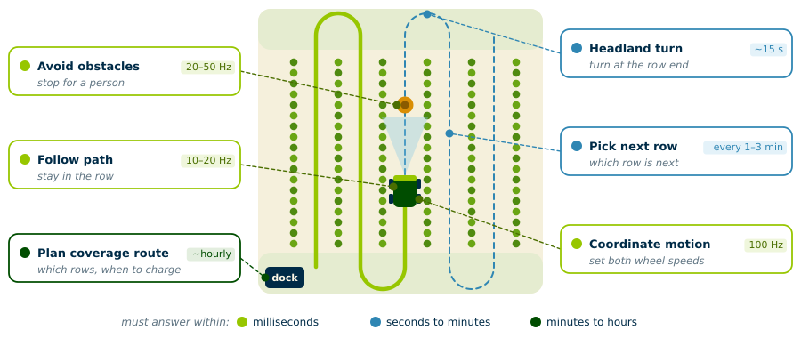

Architectures **decompose** these jobs into layers, in two ways: by **time** and by **task**.

<!-- end_slide -->

Split by time: slow on top, fast below
======================================

By **time**: sort the jobs by how often they must answer. Each layer runs about **10× slower** and is **more abstract** than the one below.

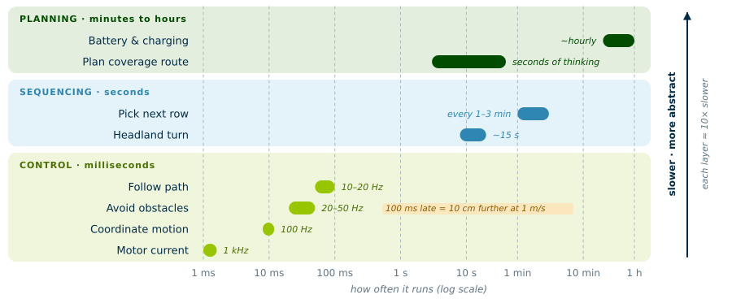

<!-- end_slide -->

Split by task: big jobs become small steps
==========================================

By **task**: a job on one layer is done by calling jobs on the layer below, **in order**.

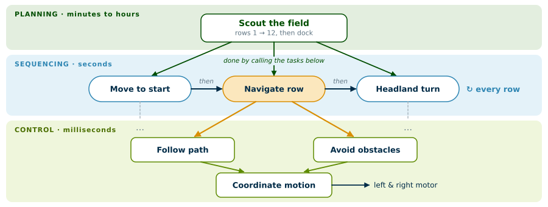

Open question: where does **PLAN** sit, and does **ACT** have to wait for it? Robotics has tried three answers.

<!-- end_slide -->

<!-- jump_to_middle -->

Paradigms
=========

Three ways to connect sense, plan and act

<!-- end_slide -->

Hierarchical
============

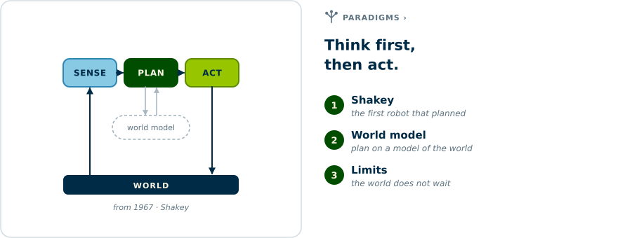

<!-- end_slide -->

Shakey: sense, then plan, then act
==================================

<!-- column_layout: [3, 2, 2] -->

<!-- column: 0 -->

* **Shakey** (SRI, late 1960s): the first robot that reasoned about its own actions
* Camera, rangefinder and bump sensors; differential drive
* Strictly in turn: **sense** the world, **plan** on a world model, **act**

<!-- column: 1 -->

<!-- column: 2 -->

<!-- reset_layout -->

*Photo: SRI International, CC BY-SA 3.0, via Wikimedia Commons*

<!-- end_slide -->

Plan on a world model
=====================

<!-- column_layout: [1, 1] -->

<!-- column: 0 -->

* All sensor data goes into one **world model**
* A **planner** searches the model for the best sequence of actions
* **A\*** on a grid map was invented for Shakey (Hart, Nilsson & Raphael, 1968)
* Optimal and predictable, **if** the model is right

<!-- column: 1 -->

<!-- reset_layout -->

<!-- end_slide -->

The world does not wait
=======================

* Planning takes **long**, and the robot is **blocked** while it waits
* The plan runs **without sensing**, which is dangerous in a dynamic world

<!-- end_slide -->

Reactive
========

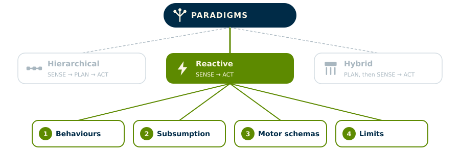

<!-- end_slide -->

Cut out the planner
===================

Brooks (1986): instead of one pipeline of functions, many **behaviours**, each a direct link from SENSE to ACT, all running at once.

<!-- end_slide -->

Subsumption: layers of behaviours
=================================

Layers run **in parallel**. A higher layer **suppresses** (S) the command of the layer below: arbitration by priority (Brooks, 1986).

<!-- end_slide -->

Motor schemas: blend behaviours
===============================

<!-- column_layout: [2, 3] -->

<!-- column: 0 -->

* Arkin (1989): every behaviour outputs a **vector**
  * *move-to-goal* pulls towards the goal
  * *avoid-obstacle* pushes away, harder when closer
* The robot follows the **sum**
* Subsumption **picks** one behaviour, motor schemas **blend** them all

<!-- column: 1 -->

<!-- reset_layout -->

<!-- end_slide -->

Fast, but short-sighted
=======================

<!-- column_layout: [2, 3] -->

<!-- column: 0 -->

* Responds in milliseconds, needs no world model
* But:
  * **No memory**: which rows are already done?
  * **No foresight**: when should it go and charge?
  * **Hard to predict**: behaviour emerges
  * **Gets stuck**: forces can cancel out

<!-- column: 1 -->

<!-- reset_layout -->

<!-- end_slide -->

Hybrid
======

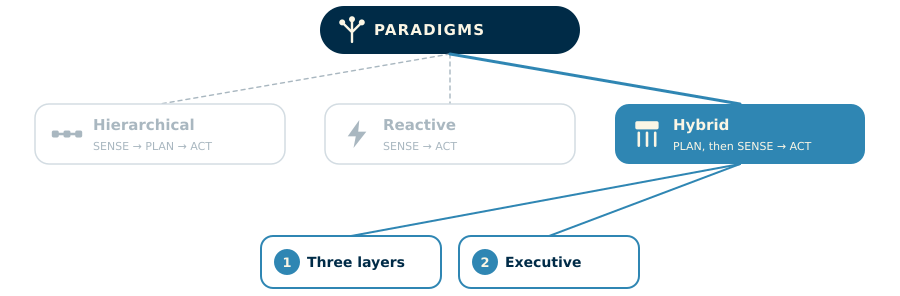

<!-- end_slide -->

Plan on top, react below
========================

The time and task layers from the start, each with one job (Firby; 3T; Gat, 1998): behaviours below, a planner on top, and an **executive** in between.

<!-- end_slide -->

The executive switches behaviours
=================================

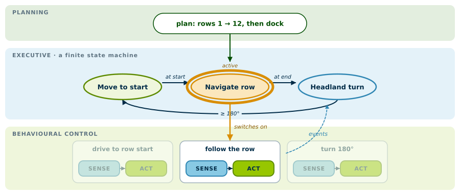

The executive turns the plan into **one behaviour at a time** and switches when an **event** happens. Most robots today are hybrid, and this executive is often a **finite state machine**: what you will build.

<!-- end_slide -->

<!-- jump_to_middle -->

State machines
==============

Programming the executive layer

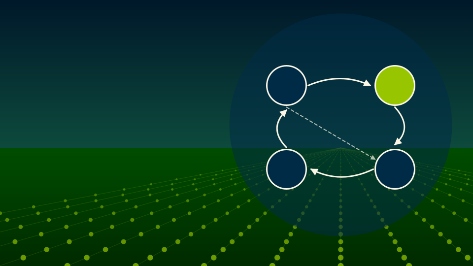

<!-- end_slide -->

Anatomy of a state machine
==========================

The robot's battery as a state machine: it scouts until the battery runs low, drives back to the dock, and charges.

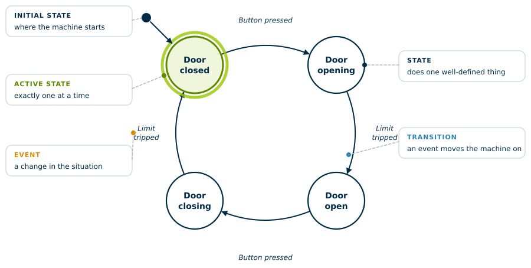

<!-- end_slide -->

States can have several transitions
===================================

The robot must also stop for people: one new state, **Wait**. *Scout rows* now has **two** ways out, and the event decides which one is taken.

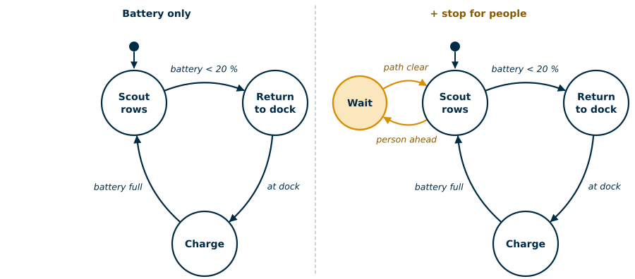

<!-- end_slide -->

CropScout: three behaviours, three states
=========================================

<!-- column_layout: [1, 1] -->

<!-- column: 0 -->

A field robot that scouts a crop row after row, with three behaviours:

<!-- column: 1 -->

What does the FSM look like?

<!-- pause -->

<!-- reset_layout -->

<!-- end_slide -->

One state at a time
===================

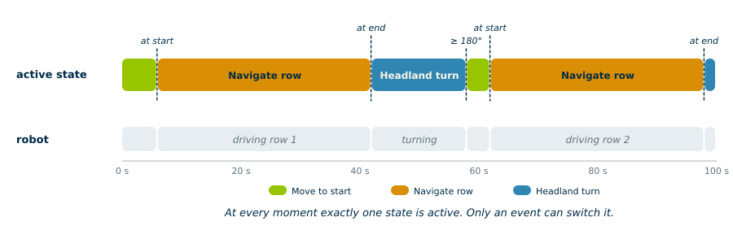

<!-- end_slide -->

Every arrow is one row
======================

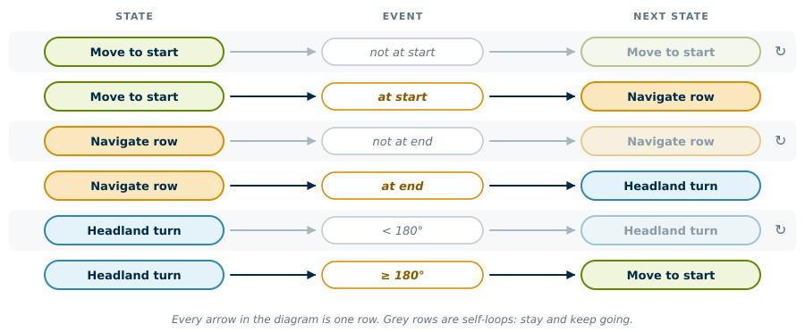

<!-- end_slide -->

How an FSM runs, cycle after cycle
==================================

<!-- end_slide -->

Your turn
=========

<!-- column_layout: [1, 1] -->

<!-- column: 0 -->

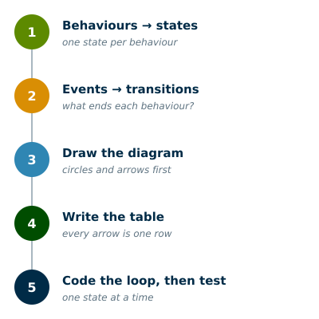

<!-- column: 1 -->

1. Notebook *t08_state_machine*
2. Webots assignment: *t08_state_machine_webots_assignment.pdf* and *t08_webots.zip*

[Expected behaviour](robot-architectures/expected-behaviour.mp4)

<!-- reset_layout -->
