Outline
=======

* Robot architectures
* Finite State Machine

<!-- new_lines: 2 -->

*Kortenkamp, D., Simmons, R., & Brugali, D. (2016). Robotic systems architectures and programming. Springer handbook of robotics, 283-306*

<!-- end_slide -->

<!-- jump_to_middle -->

Robot architectures
===================

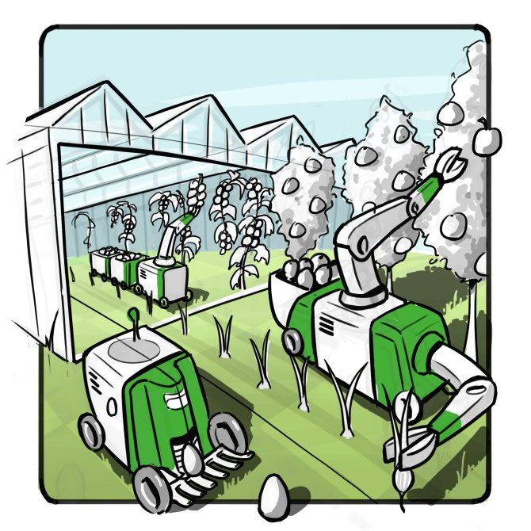

<!-- end_slide -->

What is robot architecture
==========================

* It refers how a system is **divided into subsystems** and how those subsystems interact. E.g,
  * **Different processes**: sensing, thinking, acting
  * Multiple behaviors
* Deals with the **coordination of these behaviors**

<!-- new_line -->

* It is distinguished from other software architectures because of the special needs of robot systems.

<!-- end_slide -->

What are the special needs of robot architecture
================================================

* Interaction in **real-time**, with an uncertain, often dynamic, environment
  * Controlling sensors and actuators
  * Responding to events in the environment
  * Dealing with uncertainty

<!-- end_slide -->

What are the special needs of robot architecture
================================================

* Responding at **varying temporal scopes**
  * Behavior-based reflexes
  * Deliberative long-term planning
* **Coordinating** different behaviors:
  * Eg. path planning, navigation, obstacle avoidance.
  * Sequential or in parallel

<!-- end_slide -->

Modularity and hierarchy
========================

* **Modular decomposition** of the overall system in simpler, largely independent pieces
* Often **hierarchical**
  * Modules build on top of others
  * Different layers in the hierarchy: different levels of abstraction
  * *Task decomposition*: E.g: harvesting = reaching + detach +..
  * *Temporal decomposition*: Sequence of actions

<!-- end_slide -->

Robot architecture: structure and style
=======================================

* Structure:
  * How to decompose the overall system
* Style:
  * How the components interact/communicate

```faqe:graph
columns = 7
rows = 3
[[nodes]]
id = "gps"
title = "GPS/GNSS"
column = 1
row = 1
tone = "accent"
[[nodes]]
id = "distance"
title = "Distance sensor"
column = 1
row = 3
tone = "accent"
[[nodes]]
id = "follow"
title = "Follow path"
column = 3
row = 1
[[nodes]]
id = "avoid"
title = "Avoid obstacles"
column = 3
row = 3
[[nodes]]
id = "coordinate"
title = "Coordinate motion"
column = 5
row = 2
[[nodes]]
id = "left"
title = "Left motor"
column = 7
row = 1
tone = "warning"
[[nodes]]
id = "right"
title = "Right motor"
column = 7
row = 3
tone = "warning"
[[edges]]
from = "gps"
to = "follow"
[[edges]]
from = "distance"
to = "avoid"
[[edges]]
from = "follow"
to = "coordinate"
[[edges]]
from = "avoid"
to = "coordinate"
[[edges]]
from = "coordinate"
to = "left"
[[edges]]
from = "coordinate"
to = "right"
```

<!-- end_slide -->

History: Shakey robot at Stanford University (late 1960s)
=========================================================

<!-- column_layout: [3, 1] -->
<!-- column: 0 -->

* Sensors: camera, a rangefinder, and bump sensors
* Actuators: differential drive
* Decomposition: sensing, planning, and execution
* The sense-think-act paradigm

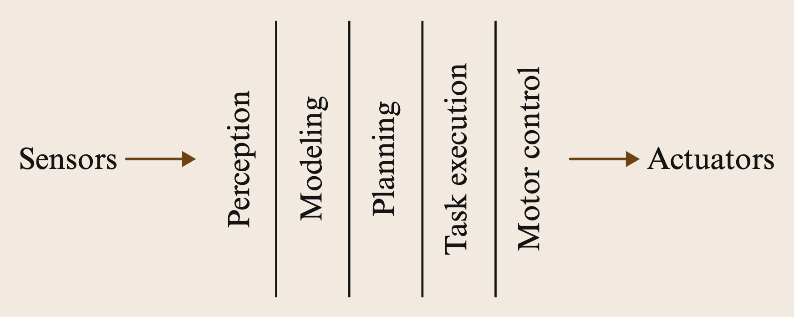

<!-- column: 1 -->

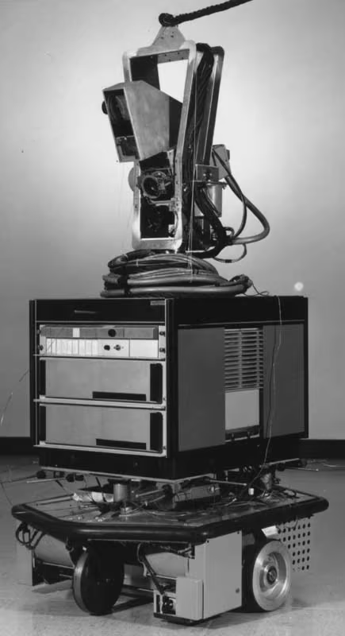

<!-- reset_layout -->

<!-- end_slide -->

History: downside of SPA paradigm
=================================

<!-- column_layout: [1, 1] -->
<!-- column: 0 -->

* Limitations of the Sense-Plan-Act paradigm:
  * Planning took a **long time**, and the robot would be **blocked**, waiting for planning to complete
  * Execution of a plan without involving sensing was **dangerous in a dynamic world**

<!-- column: 1 -->

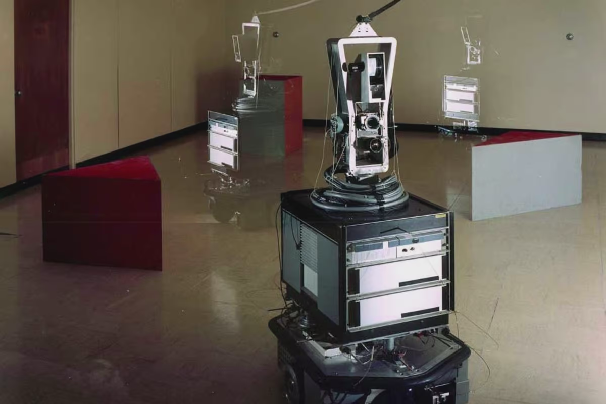

<!-- reset_layout -->

<!-- end_slide -->

History: reactive behavior-based paradigms
==========================================

* Focus on reactive planners, real-time interaction with environment
  * Rodney Brooks, Ronald Arkin, …
* Example: office mail delivery robot

```faqe:graph
columns = 5
rows = 2
[[nodes]]
id = "camera"
title = "Camera"
column = 1
row = 1
tone = "accent"
[[nodes]]
id = "detect"
title = "Detect room nr"
column = 2
row = 1
[[nodes]]
id = "move"
title = "Move to room"
column = 3
row = 1
[[nodes]]
id = "deliver"
title = "Deliver mail"
column = 4
row = 1
[[nodes]]
id = "release"
title = "Release mail"
column = 5
row = 1
tone = "warning"
[[nodes]]
id = "wander"
title = "Wander"
column = 2
row = 2
[[nodes]]
id = "subsume"
title = "Subsume"
column = 3
row = 2
tone = "muted"
[[nodes]]
id = "drive"
title = "Drive"
column = 5
row = 2
tone = "warning"
[[edges]]
from = "camera"
to = "detect"
[[edges]]
from = "detect"
to = "move"
[[edges]]
from = "move"
to = "deliver"
[[edges]]
from = "deliver"
to = "release"
[[edges]]
from = "move"
to = "subsume"
[[edges]]
from = "wander"
to = "subsume"
[[edges]]
from = "subsume"
to = "drive"
```

* Downside:
  * Difficult to construct for more complex behaviors

<!-- end_slide -->

<!-- jump_to_middle -->

Different paradigms
===================


<!-- end_slide -->

Two types of robotic responses
==============================

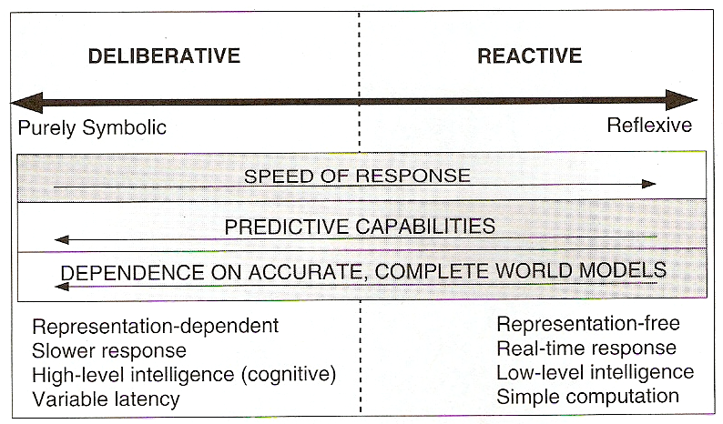

*Arkin (1998)*

<!-- end_slide -->

Deliberative planning
=====================

* Sense-think-act paradigm

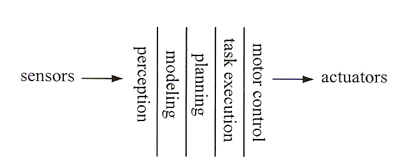

*Brooks (1986)*

<!-- end_slide -->

Deliberative planning
=====================

* Sense-think-act paradigm

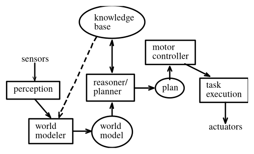

<!-- end_slide -->

Reactive planning
=================

* Behaviour-based approach

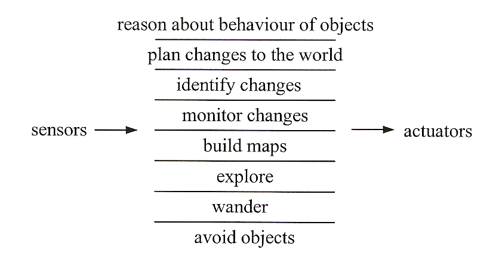

*Brooks (1986)*

<!-- end_slide -->

Subsumption
===========

<!-- column_layout: [3, 2] -->
<!-- column: 0 -->

* **Decomposing** the complete behavior into **sub-behaviors**
  * Each behavior connects sensors to actuators
* Organized into a **hierarchy of layers**
* **Arbitration mechanism** that enabled higher-level behaviors to override signals from lower-level behaviors: priorities
* The layers **work in parallel**

<!-- column: 1 -->

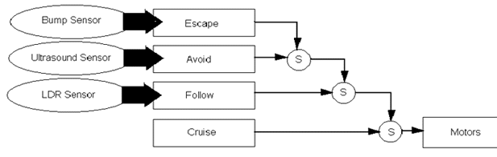

<!-- reset_layout -->

<!-- end_slide -->

Layered Robot Control Architectures
===================================

<!-- column_layout: [1, 1] -->
<!-- column: 0 -->

* The Three-Layer Architecture:
* Hybrid reactive/ deliberative robot architecture (R. James Firby)
* 3T architecture
  * Behavior control
  * Sequencing/coordination
  * Planning

<!-- column: 1 -->

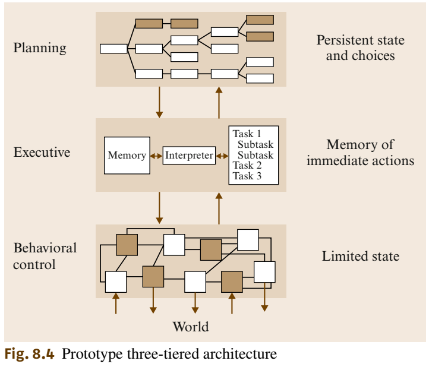

<!-- reset_layout -->

<!-- end_slide -->

Layered Robot Control Architectures
===================================

<!-- column_layout: [1, 1] -->
<!-- column: 0 -->

* The **executive layer**
  * Not all low-level behaviors should be active at the same time
  * Coordinating behaviors
  * Achieving high-level tasks
  * Avoiding conflicts

<!-- column: 1 -->


<!-- reset_layout -->

<!-- end_slide -->

<!-- skip_slide -->
<!-- jump_to_middle -->

Example
=======


<!-- end_slide -->

<!-- skip_slide -->

Behavioral-control layer
========================

<!-- column_layout: [1, 1] -->
<!-- column: 0 -->

* **Situated behaviors**
  * Active in specific situations
* **Cognizant failure**
  * Behaviors should communicate failure to executive layer
* **Constraints**
  * Fast, reactive, high frequent, constant time
  * Only small world model

<!-- column: 1 -->

**Simple low-level behaviors**

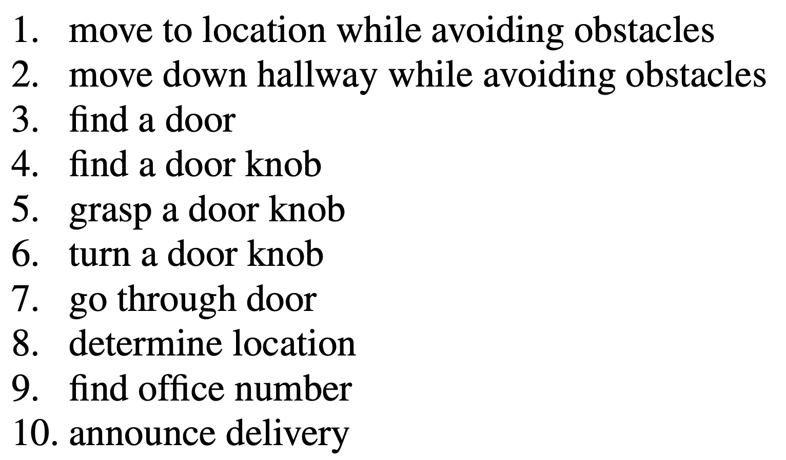

<!-- reset_layout -->

<!-- end_slide -->

<!-- skip_slide -->

Executive layer
===============

<!-- column_layout: [1, 1] -->
<!-- column: 0 -->

* Role executive layer
  * Translating high-level plans (goals) in low-level behaviors
  * Coordinating low-level behaviors
  * Monitor execution / handling exceptions
  * Error recovery
* Executive layer describes how to achieve tasks

<!-- column: 1 -->

**Task decomposition**

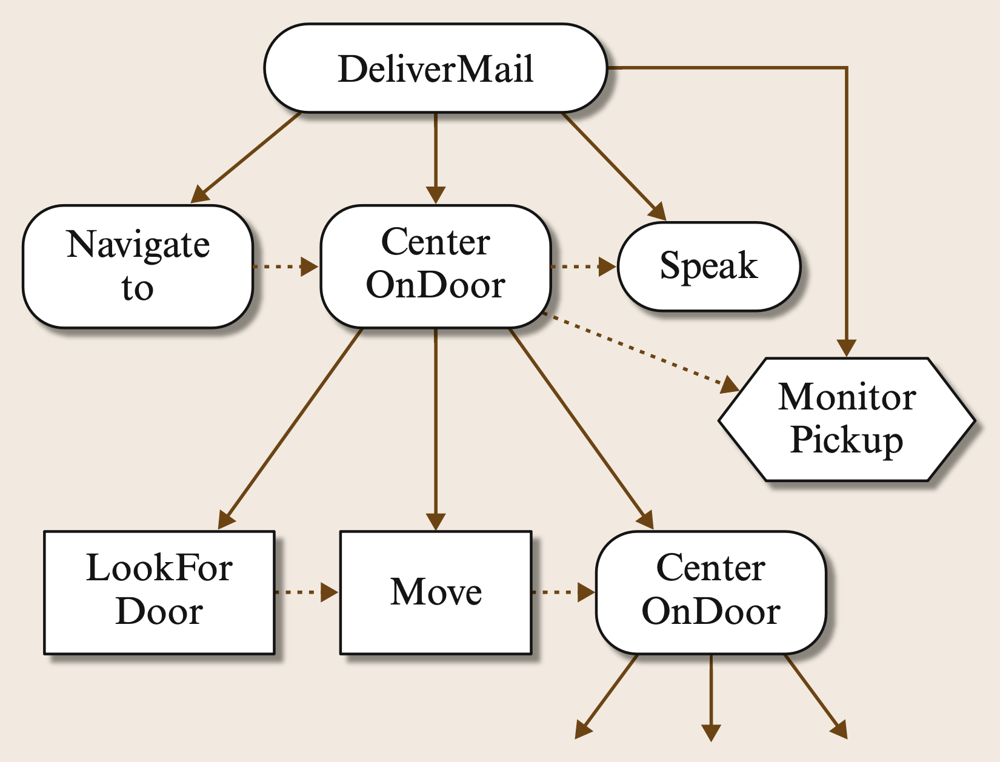

<!-- reset_layout -->

<!-- end_slide -->

<!-- skip_slide -->

Planning layer
==============

<!-- column_layout: [3, 2] -->
<!-- column: 0 -->

* Planner/scheduler
  * High-level plan of (sub)tasks
  * Including: goals, resources, duration, and constraints
* Role of planner in architecture
  * Planners called by the executive layer when needed
  * Planners always active, sending tasks down and monitoring progress

<!-- column: 1 -->

> **Planners**
>
> * Planning task schedules
> * Getting mail delivery information
> * Route planner
>   * Map of the building
>   * Mail recipients
>   * Capacity of the robot
>   * …

<!-- reset_layout -->

<!-- end_slide -->

<!-- jump_to_middle -->

Finite-state machine
====================


<!-- end_slide -->

Finite state machine (FSM)
==========================

<!-- column_layout: [2, 1] -->
<!-- column: 0 -->

* Finite state machine: number of *states* that each performs a **well-defined function to operate the robot** in a specific situation
* *Events* that reflect a **change in the robot's situation** cause a **transition** from one state to another
* There is always **one state active**
* The **FSM diagram** provides a graphical representation of states and transitions

<!-- column: 1 -->

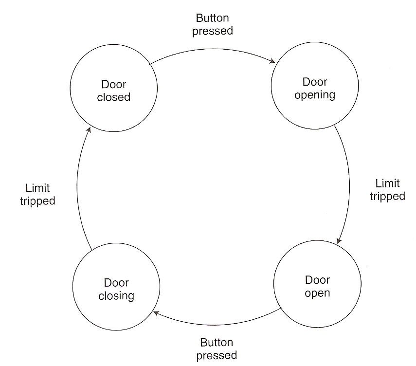

<!-- reset_layout -->

<!-- end_slide -->

Finite state machine an example
===============================

* States can have multiple transitions to other states

<!-- column_layout: [1, 1] -->
<!-- column: 0 -->


<!-- column: 1 -->

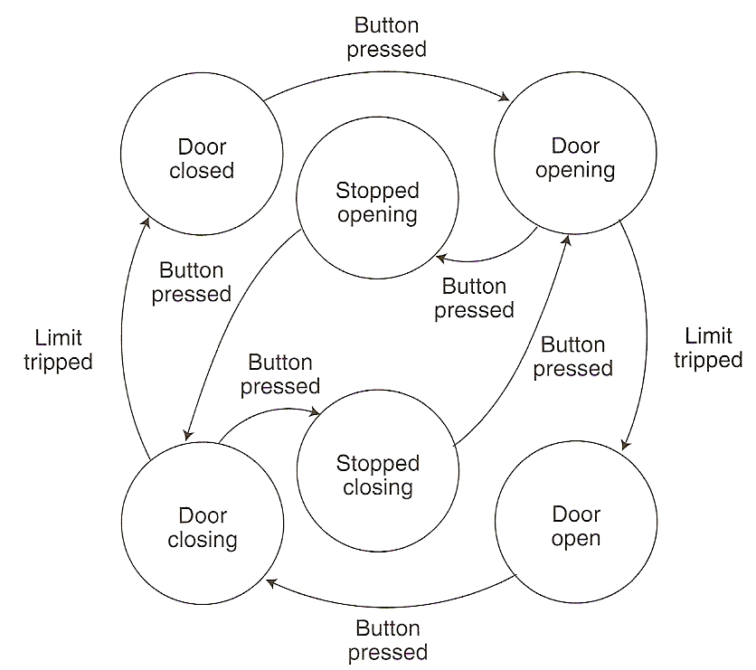

<!-- reset_layout -->

<!-- end_slide -->

Finite state machine – example
==============================

Cropscout

<!-- column_layout: [1, 1] -->
<!-- column: 0 -->

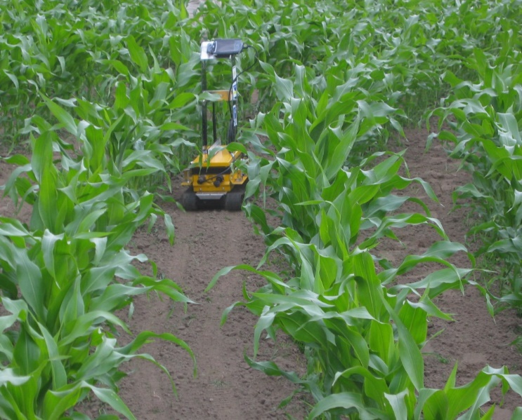

<!-- column: 1 -->

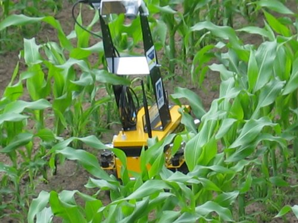

<!-- reset_layout -->

<!-- end_slide -->

Finite state machine – example
==============================

<!-- column_layout: [1, 1] -->
<!-- column: 0 -->

* Cropscout’s three main behaviors/states:
  * **Move to start of row**
  * *Navigate through the row*
  * Perform headland turn

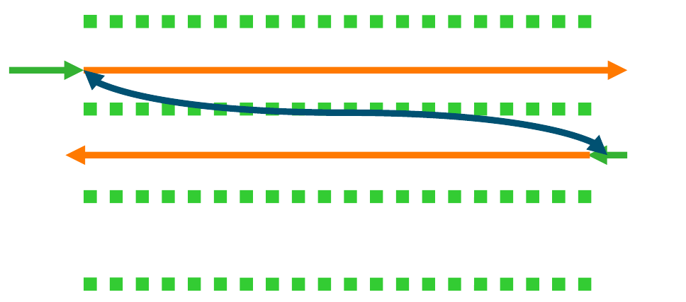

<!-- column: 1 -->

How does this FSM diagram look like?

<!-- pause -->

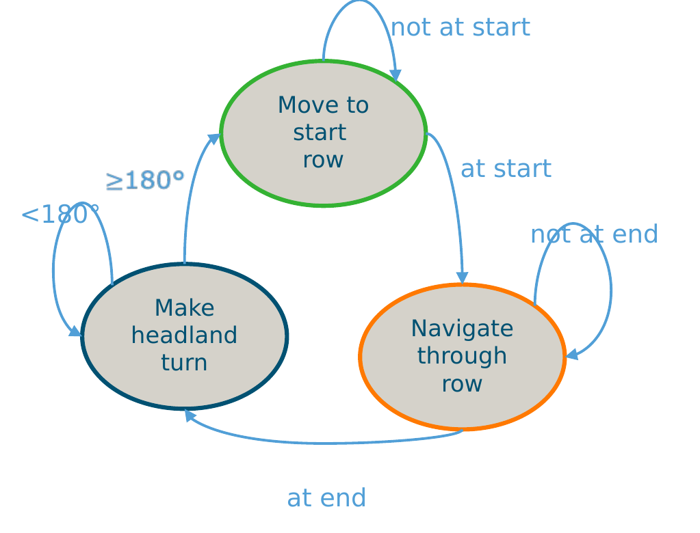

<!-- reset_layout -->

<!-- end_slide -->

Time to work with FSM yourself
==============================

<!-- column_layout: [1, 1] -->
<!-- column: 0 -->

1. Notebook *t08_state_machine*
2. Webots assignment: *t08_state_machine_webots_assignment.pdf* and *t08_webots.zip*

<!-- column: 1 -->

[Expected behaviour](robot-architectures/expected-behaviour.mp4)

<!-- reset_layout -->
